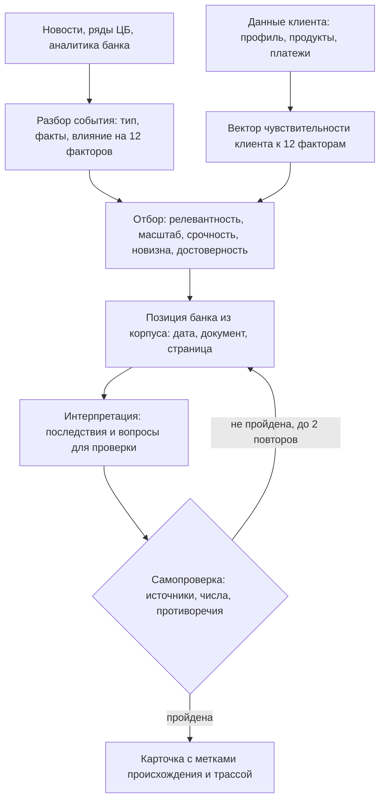

# NAFA. Бизнес-модель и бизнес-логика

> Команда: The Great New Alliance. Кейс: «Новостная аналитика для принятия бизнес-решений» (Changellenge × Альфа-Банк). Версия от 22.10.2026.
> Здесь только суть: кому и зачем нужен сервис, как он приносит пользу банку и по каким правилам принимает решения. Требования, метрики, источники, формулы, графики, бюджет и риски собраны в справочнике `05_reference_metrics_sources_formulas.md`; ссылки вида «справочник, раздел 8.1» ведут туда.
> Пометка **(допущение)** означает, что в кейсе этого нет и мы проверяем это сами.

---

## 1. Суть

NAFA — ИИ-сервис на главном экране интернет-банка Альфа-Бизнес для руководителей крупных компаний (выручка свыше 15 млрд ₽). Он отвечает не на вопрос «что произошло», а на три других: что это значит для компании пользователя, что об этом думает банк и что стоит проверить или обсудить.

Ценность создаёт произведение трёх величин: **событие × контекст компании × позиция банка**. Если любой из множителей равен нулю, получается уже известный продукт. Лента без контекста компании остаётся шумом. Новость, пересказанная универсальным чат-ботом, не знает ни компании, ни банка. Позиция банка без привязки к событию превращается в рассылку. Кейс прямо запрещает «ленту с пересказом» (R01), поэтому вся модель построена так, чтобы показывать меньше, но точнее.

---

## 2. Бизнес-модель

### 2.1 Для кого и какую проблему решаем

Пользователь — лицо, принимающее решения (ЛПР) в крупной компании: собственник, генеральный директор, финансовый директор, казначей, главный бухгалтер, другой C-level. По условиям кейса у таких клиентов уже есть собственные аналитические ресурсы, поэтому ценность не в доступе к новостям. Проблема в другом:

1. **Объём.** В день выходят сотни событий, и большинство из них не про эту компанию.
2. **Перевод.** «Ключевая ставка сохранена на 14%» не говорит, что это значит для компании с кредитом и лизингом, и означает почти противоположное для компании с крупными депозитами.
3. **Доверие.** Непонятно, где подтверждённый факт, где мнение аналитиков банка, а где догадка модели.

Сегодня ЛПР закрывает эту задачу лентами и каналами, терминалами, собственными аналитиками и универсальными чат-ботами. Каждый вариант решает часть задачи. Ни один не знает платежей, продуктов и отрасли клиента внутри банка и не опирается на датированную позицию банка с указанием документа (допущение: сравнение выполнено рассуждением, а не тестами конкурентов).

### 2.2 Ценностное предложение

| Участник | Боль сегодня | Что получает от NAFA | Как проверяем |
|---|---|---|---|
| ЛПР клиента | Читать ленты и отчёты, самому переводить их на язык своей компании | До пяти событий в день, у каждого ответ на вопрос «Почему это вам», последствия, действия и ссылки на источники | Полезность (Q-18), глубина (Q-30), переходы к источнику (Q-20) |
| Банк | Экспертиза Центра макроанализа и Альфа-КИБ доходит не до всех, не вовремя и без привязки к клиенту; нет повода часто заходить в интернет-банк | Доставка нужного абзаца аналитики нужному человеку в момент, когда он важен; регулярная польза на главном экране | Q-09, Q-22 |
| Аналитики банка | Материал копируется и теряет дату и контекст | Позиция всегда с датой, документом и страницей; смена версий видна | Q-28 |

### 2.3 Как банк получает отдачу

Альфа-Банк не продаёт новости. Выручка универсального банка с крупного бизнеса складывается из процентного и комиссионного дохода по продуктам, которые видны в данных кейса: кредиты, лизинг, гарантии, факторинг, депозиты, расчётно-кассовое обслуживание, зарплатный проект, внешнеторговые операции (допущение: общая модель универсального банка, цифры Альфа-Банка мы не используем). NAFA влияет на этот доход четырьмя путями.

| Механизм | Как работает | Что нужно | Метрика |
|---|---|---|---|
| Статус основного банка | Регулярная польза на главном экране повышает частоту входов и доверие, а значит долю операций клиента, которые идут через банк | Заметная точка входа, стабильное качество карточек | Q-22, Q-18 |
| Продукт в момент потребности | Событие порождает потребность (ставка высока дольше ожидаемого — рефинансирование или депозит; курс — ВЭД), рядом показывается уместное предложение | Правило из раздела 2.7, отдельный блок с пометкой | Q-21 |
| Тиражирование экспертизы | Отчёты Центра макроанализа и Альфа-КИБ работают не только в рассылке: нужный вывод попадает в карточку конкретной компании с датой и ссылкой | OCR корпуса, версионность позиции, цитирование | Q-09, Q-28 |
| Радар рисков по клиентской базе (после MVP, допущение) | Те же векторы чувствительности компаний, сложенные по портфелю, показывают, сколько клиентов уязвимы к ставке, курсу, топливу. Видно до первых просрочек | Накопленные векторы экспозиций, согласие на использование данных | Индекс FM-21 по клиентам |

Мы исходим из того, что прямой платной подписки нет (допущение). Поэтому итог продукта измеряется не числом прочитанных новостей, а числом карточек, после которых клиент что-то сделал: открыл источник, задал вопрос, оценил полезность, обратился в банк.

### 2.4 Экономика: что стоит и почему затраты растут медленнее числа клиентов

Затраты: токены LLM (главная переменная статья), разбор PDF-отчётов (один раз, результат кэшируется), хостинг, экспертная разметка и развитие справочников. Открытые RSS-ленты и данные Банка России ничего не стоят. Тарифы токенов в кейсе не названы (OQ-05), поэтому мы работаем с формулами, а не с рублёвыми оценками.

Главное решение, которое делает модель масштабируемой: **событие общее для многих клиентов, поэтому его разбор делается один раз**. Ядро события (тип, факты, позиция банка, цепочка влияния) считается и кэшируется. Для каждого клиента добавляется короткий персональный слой. Скоринг релевантности вообще не тратит токены: это код. Стоимость карточки:

`cost_карточки = C_ядро / k + C_персональный_слой`, где `k` — число клиентов, для которых событие прошло порог.

Без такого разделения стоимость росла бы как «события × клиенты»; с ним — как «события + клиенты × 5 карточек». Для хакатона это дополнительно ограничено лимитом 500 ₽ на общем ключе (R04), расчёт бюджета в справочнике, раздел 11.

Условие окупаемости в промышленной эксплуатации (допущение; параметры известны только банку и измеряются в пилоте):

`p_действие · p_продажа · Маржа  >  c_карточки + Фикс / (N · n_карточек)`

Здесь `p_действие` — доля карточек, после которых клиент обратился в банк, `p_продажа` — доля обращений, закончившихся сделкой, `Маржа` — средняя маржа сделки, `c_карточки` — стоимость одной карточки, `Фикс` — постоянные затраты за период, `N` — число активных ЛПР, `n_карточек` — карточек на ЛПР за период. Смысл: одна карточка должна в среднем приносить больше, чем стоит. Конкретные числа мы не подставляем, чтобы не придумывать их; воронка из раздела 2.5 даёт банку способ измерить первые два параметра.

### 2.5 Как измеряем успех

Главный показатель (North Star): **доля показанных карточек, после которых ЛПР сделал следующий шаг**. Он складывается в воронку.

| Шаг | Что значит | Метрика |
|---|---|---|
| Вход | Пользователь заметил виджет и открыл ленту | Q-22 |
| Открытие | Открыл карточку из топ-5 | Q-31 (воронка) |
| Углубление | Задал вопрос, перешёл к источнику | Q-19, Q-20 |
| Оценка | Отметил «полезно» | Q-18 |
| Действие | Перешёл к предложению банка | Q-21 |

Вовлечённость нельзя наращивать ценой точности, поэтому рядом стоят защитные показатели: доля фактологических ошибок (Q-03), индекс галлюцинаций (Q-29), точность персонализации (Q-05) и трассируемость (Q-28). На хакатоне воронка измеряется на демо и синтетических клиентах, в пилоте — на реальных.

### 2.6 Почему это трудно повторить

1. **Контекст клиента внутри банка.** Продукты, платежи, отрасль, группа компаний есть у банка и отсутствуют у новостной ленты или общего чат-бота.
2. **Позиция банка.** Собственная аналитика с датами и версиями: прогноз ставки на конец 2026 года менялся с 13,5% до 14,0%, и система должна уметь показать это изменение.
3. **Место и право.** Главный экран интернет-банка и допустимая по кейсу нативная реклама банковских продуктов.

### 2.7 Правило уместного предложения банка

Кейс разрешает рекламу, но она не должна ломать доверие. Предложение показывается только если выполнены **все** условия:

1. Событие прошло порог релевантности для этого клиента.
2. Продукт логически решает проблему, описанную в карточке.
3. Для действующего клиента продукта нет, либо есть что расширить. Для потенциального клиента предложение формулируется как знакомство, без утверждений об использовании продуктов.
4. Блок помечен «Предложение банка» и визуально отделён от аналитики.

Соответствие «проблема → продукт» ограничено продуктами, которые отражены в данных кейса (допущение, подтвердить с экспертом банка):

| Проблема из карточки | Продукт из набора данных |
|---|---|
| Дорогой долг при высокой ставке, рефинансирование | кредитные продукты (LOA), лизинг (LEA) |
| Свободная ликвидность при высокой ставке | депозиты (DEP) |
| Валютные риски и расчёты по ВЭД | продукты ВЭД (FTS) |
| Дефицит оборотного капитала, задержки платежей | факторинг (FACTORING) |
| Участие в госзакупках и контрактах | гарантии (GAR) |
| Рост затрат на персонал, удержание сотрудников | зарплатный проект (ZPP) |
| Управление расчётами и платёжной дисциплиной | РКО (RKO) |

### 2.8 Риски модели

| Риск | Как снимаем |
|---|---|
| Навязчивая реклама разрушает доверие | Правило 2.7, отдельный помеченный блок, показ только при релевантности |
| Вывод воспринимается как инвестиционная рекомендация | Оговорка на каждой карточке; действия формулируются как «стоит обсудить» и «вопросы для проверки» |
| Устаревшая или противоречивая позиция банка | Дата и документ у каждой записи; последняя версия активна, прошлая помечена; «обновления нет», если новее материалов нет |
| Мало данных о клиенте | Типичный профиль отрасли вместо выдумки, пониженная уверенность и честная пометка «данных нет» |
| Отчёты нельзя копировать без разрешения | Короткие фрагменты с атрибуцией внутри прототипа, ссылка на документ и страницу |

---

## 3. Пользователи и сценарий

### 3.1 Персоны и их работы

У одной компании несколько пользователей с разными ролями. В данных поля роли нет, поэтому роль выбирается в интерфейсе и меняет порядок событий, но не скрывает важное.

| PER | Роль | Работа, которую нужно сделать (JTBD) | Ключевые темы | Горизонт решений |
|---|---|---|---|---|
| PER-01 | Собственник | Защитить стоимость бизнеса и репутацию; понять риски для группы и ключевых контрагентов | Стратегические риски, структура группы, геополитика, контрагенты | месяцы-годы |
| PER-02 | Генеральный директор | Принимать решения о росте, ценах и инвестициях с учётом внешней среды | Спрос, цены, конкуренты, регуляторика, крупные контракты | недели-кварталы |
| PER-03 | Финансовый директор | Управлять стоимостью долга, ликвидностью и бюджетом; понимать влияние ставки и курса на план | Ставка, кредит, курс, covenants, рефинансирование, налоги | недели-кварталы |
| PER-04 | Руководитель казначейства | Управлять ликвидностью, валютной позицией и размещением остатков | Ставка, RUONIA, курс, депозитные ставки, лимиты контрагентов | дни-недели |
| PER-05 | Главный бухгалтер | Не пропустить изменения в налогах и отчётности; корректно отразить эффекты | Налоги, законы, требования ЦБ и регуляторов, валютный контроль | дни-месяцы |
| PER-06 | Другой C-level (операционный, коммерческий, закупки) | Обеспечить поставки, себестоимость и продажи | Топливо и логистика, сырьё, спрос, поставщики, ФОТ | недели-кварталы |

### 3.2 Одна новость, разные клиенты

Событие «Банк России сохранил ключевую ставку на 14,0%, риторика жёстче» одинаково для всех. Для клиентов оно разное:

| Клиент (синтетический архетип) | Что наверху ленты | Почему |
|---|---|---|
| CA-01 Строитель-заёмщик: кредит, лизинг, без депозитов | Решение по ставке | Долг остаётся дорогим дольше, финансовая нагрузка не снижается; эффект отрицательный |
| CA-02 Металлург-экспортёр в КНР | Курс юаня и ставка | Валютная выручка и кредит: два фактора, направление ВЭД неизвестно, поэтому две ветви вывода и вопрос пользователю |
| CA-03 Золотодобытчик с избытком ликвидности | Золото и решения ФРС; решение по ставке ниже в ленте | Чистый вкладчик: высокая ставка скорее выгодна, а главный фактор — цена золота |

Полный демо-сценарий на 3-5 минут, который проходит по критериям C01-C12, описан в справочнике, разделы 4.3 и 4.4.

---

## 4. Бизнес-логика

### 4.1 Путь события до карточки

Шаги простыми словами:

1. **Контекст клиента.** Из полей клиента, продуктов и платежей строится вектор чувствительности к 12 факторам: ставка, курс, инфляция, топливо и энергия, сырьё, спрос, труд, кредит, бюджет, регулирование, геополитика, контрагенты. Если данных мало, берётся типичный профиль отрасли по ОКВЭД; недостающее не придумывается.
2. **Событие.** Каждое событие получает тип и вектор влияния на те же 12 факторов.
3. **Отбор.** Релевантность показывает, насколько клиент чувствителен именно к тем факторам, которые затрагивает событие. Дальше учитываются масштаб, срочность, новизна, достоверность и интерес роли. Ниже порога событие не показывается: так отсекается шум.
4. **Позиция банка.** Поиск по аналитике Центра макроанализа и Альфа-КИБ. Всегда с датой, документом и страницей; при нескольких версиях активна последняя, смена версии показывается.
5. **Интерпретация.** Цепочка «событие → фактор → экспозиция клиента → последствие → вопрос или действие». Знак эффекта и числа задаёт код, а не модель.
6. **Самопроверка.** Независимая модель сверяет утверждения с источниками, числа с рядами, версии между собой и полноту ответа. Только после этого появляется карточка.

Детали шагов (инструменты агента, схема карточки, правила пропусков и конфликтов) — в справочнике, раздел 5.

### 4.2 Как считается релевантность

Две величины, обе считает код:

`Rel = 0,7 · Cov + 0,3 · Match`, где `Cov = Σ ε_f · ι_f / Σ ι_f`. Здесь `ε_f` — чувствительность клиента к фактору f, `ι_f` — влияние события на фактор, `Match` — прямое совпадение по отрасли, региону или контрагентам.

`Score = Fresh · [0,40·Rel + 0,25·Imp + 0,10·Urg + 0,10·Nov + 0,15·Cred] · (0,5 + 0,5·Pers)`. События ниже порога `Rel ≥ 0,25` отбрасываются, из оставшихся выбираются пять, не похожих друг на друга.

Мы берём взвешенное покрытие, а не косинус вектора: косинус занижает релевантность у компаний с широким профилем (строитель, чувствителен почти ко всему, получал бы низкий балл по ставке). Веса и пороги — стартовые гипотезы (допущение); они калибруются на размеченном наборе (справочник, формулы FM-06 — FM-13 и FM-18).

Пример на синтетических клиентах и событии «ставка сохранена на 14,0%» (расчёт в справочнике, раздел 8.2):

| Клиент | Cov | Rel | Итог |
|---|---|---|---|
| CA-01 строитель с кредитом и лизингом | 0,727 | 0,509 | Score 0,536, событие №1 в ленте |
| CA-07 ИТ-компания без долга, с депозитом | 0,353 | 0,247 | Ниже порога 0,25, в ленту не попадает |

Одно и то же событие по-разному ранжируется для разных клиентов: это и есть персонализация.

### 4.3 Знак эффекта

Одна новость может быть плохой для одного клиента и хорошей для другого. Знак определяет код по данным клиента, а не модель.

- **Ставка.** Если чистая процентная позиция показывает заёмщика (долг превышает депозиты), долгая высокая ставка — минус; если вкладчика — плюс; если позиция около нуля, показываются обе ветви.
- **Курс.** Направление ВЭД в данных не указано. Мы не угадываем: даём две ветви (экспортёр, импортёр) и задаём один уточняющий вопрос.
- **Сырьё.** Производитель выигрывает от роста цен, потребитель проигрывает; роль определяется отраслью.

Если данных для знака нет, карточка прямо говорит об этом и снижает уверенность.

### 4.4 Правила доверия

1. **Три слоя вывода всегда раздельны:** подтверждённые факты (со ссылкой), позиция Альфа-Банка (с датой, документом и страницей), вывод модели (с оценкой уверенности).
2. **Нет источника — нет утверждения.** Либо утверждение помечено как вывод модели.
3. **Числа считает код.** Модель их не придумывает и не пересчитывает; сценарные расчёты (например, +1 п.п. ставки при плавающем долге 1 000 млн ₽ даёт +10 млн ₽ расходов в год) выполняются по вводным пользователя.
4. **Честность о пробелах.** «Позиция банка на 14.09.2026, обновления нет» вместо экстраполяции; «данных о размере долга нет» вместо оценки.
5. **Самопроверка до показа и трассировка.** Из любой карточки восстанавливаются источники, признаки клиента, шаги и результат проверки.

### 4.5 Границы продукта

- Не даёт индивидуальных инвестиционных рекомендаций: формулировки «стоит обсудить», «вопросы для проверки», «сценарии», а не «купите» или «продайте».
- Не угадывает данные о клиенте, которых нет (направление ВЭД, размер долга). Недостающее становится вопросом пользователю или двухветвевым выводом.
- Не выполняет действий в системе клиента: только чтение.
- Не сопоставляет новости с контрагентами по названию: идентификаторы в данных обезличены, поэтому персонализация идёт по признакам (отрасль, регион, платёжный профиль).

---

## 5. Состав пакета

| Файл | Для кого | Что внутри |
|---|---|---|
| `01_BA_business_model_and_logic.md` | вся команда | этот документ: бизнес-модель и логика |
| `05_reference_metrics_sources_formulas.md` | вся команда | требования к критериям кейса, 112 метрик, источники, формулы, графы, графики, качество, бюджет, безопасность, риски, план |
| `02_TZ_backend_parsing.md` | Backend & Parsing | Parsing Sources, Descriptions of sources, Metrics |
| `03_TZ_data_analyst.md` | Data Analyst | Descriptions of metrics, Necessary formulas & calculations, Necessary graphics |
| `04_TZ_prompt_engineer.md` | Prompt Engineer | LLM mapping, объяснение обработки DA, базовые промпты |
| `data/*.csv` | все | машиночитаемые справочники: метрики, факторы, матрица отраслей, персоны, типы событий, golden set |

Каталог содержит 112 метрик в 7 группах, из них 54 приоритета P0 (обязательны для MVP).

Решения, которые нужны в начале работы:

- **Исполнитель интерфейса.** Три критерия кейса (C06, C09, C10) целиком про интерфейс, а отдельной роли в команде нет (RSK-01). Минимальный интерфейс (Streamlit, Gradio или лёгкий React) по умолчанию делает Backend; спецификация UI-01..UI-13 в справочнике, раздел 5.7.
- **Вопросы организаторам** (справочник, раздел 13.2). Самые важные: допустимость эмбеддингов, OCR и классических ML-библиотек (OQ-01), имена файлов данных (OQ-02), тарифы токенов (OQ-05), единицы выручки и словари значений (OQ-09), идентификация при запросах к источникам (OQ-11).
- **Критический путь.** Корпус Альфы без текстового слоя нужно разобрать через Qwen3-VL один раз и закэшировать: без этого нет позиции банка (C03).

---

## 6. Допущения

Нужно проверить или откалибровать: матрицу «отрасль × фактор», веса и пороги формул, веса интереса персон, соответствие «проблема → продукт», гипотезу о связи гарантий с госзаказом, справочник риска стран, цели метрик качества, оценки токенов и косвенную модель монетизации. Реальные файлы данных (CSV клиентов и платежей) на момент написания не профилировались, поэтому всё про данные построено по словарю полей из Приложения 1 к кейсу. Состав выводов по корпусу и найденные особенности материалов (отчёты без текстового слоя, обезличенные идентификаторы, устаревший отчёт по стали, смена прогноза ставки) описаны в справочнике, разделы 7 и 13.
