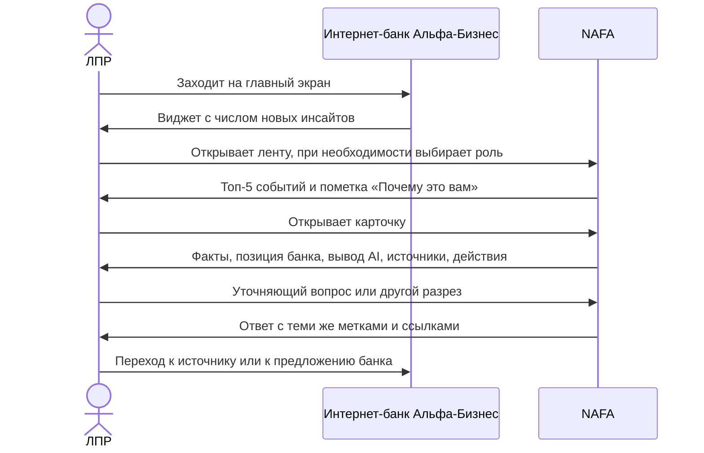
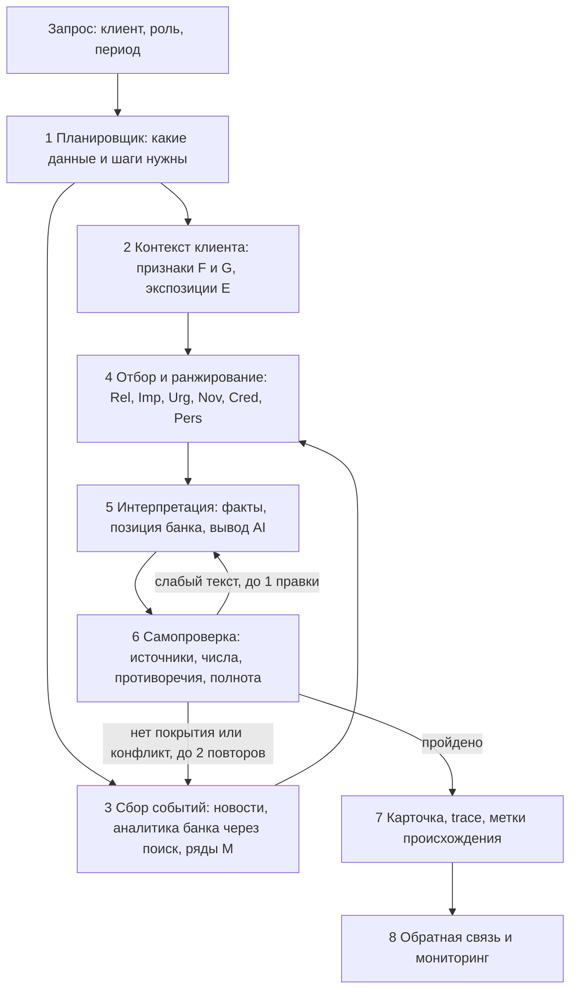
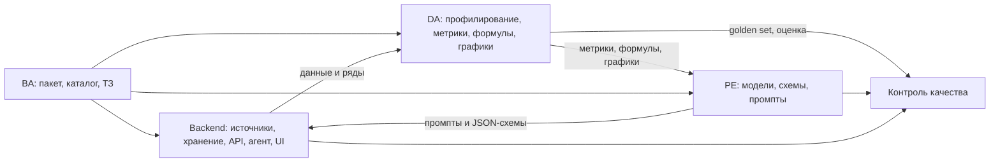

# NAFA. Справочник: требования, метрики, источники, формулы, графики, качество, бюджет, риски

> Команда: The Great New Alliance. Кейс: «Новостная аналитика для принятия бизнес-решений» (Changellenge × Альфа-Банк). Версия от 22.10.2026.
> Справочник дополняет `01_BA_business_model_and_logic.md` (бизнес-модель и логика) и служит общей опорой для ТЗ `02_TZ_backend_parsing.md`, `03_TZ_data_analyst.md`, `04_TZ_prompt_engineer.md`.
> Нумерация разделов общая для всего пакета, поэтому раздел 3 и подраздел 4.5 здесь только отсылки: бизнес-модель и границы продукта описаны в файле 01.

Условные обозначения, которые используются во всех документах пакета:

- **C01-C12** — критерии успеха кейса по порядку (стр. 9-10 кейса). **R01-R06** — ограничения кейса по порядку (стр. 11-12).
- **F/G/E/N/M/B/Q-xx** — метрики из единого каталога (раздел 6, файл `data/metrics_catalog.csv`). **FM-xx** — формулы (раздел 8). **GR-xx** — графовые структуры (раздел 8.4). **CH-xx** — графики (раздел 9). **SRC-xx** — источники (раздел 7). **DOC-xx** — документы аналитического корпуса Альфа-Банка (раздел 7.1). **SP-xx** — профили отраслей. **ET-xx** — типы событий. **PER-xx** — персоны. **CA-xx** — синтетические клиенты-архетипы. **GS-xx** — тесты золотого набора. **RSK-xx** — риски. **OQ-xx** — вопросы организаторам (раздел 13.2).
- Пометка **(допущение)** означает: в кейсе этого нет, это гипотеза команды, её нужно проверить или откалибровать. Всё без такой пометки либо прямо следует из кейса и корпуса аналитики, либо является определением.

---

## 2. Что требует кейс: критерии, ограничения, трассировка

### 2.1 Критерии успеха и как мы их закрываем

| ID | Критерий жюри | Что мы делаем | Метрика приёмки | Владелец |
|---|---|---|---|---|
| C01 | Определяет контекст клиента и отбирает значимые события | Профиль F, сеть платежей G, вектор экспозиций E-14, ранжирование FM-06..FM-13 | Q-04, Q-05, Q-07 | DA, Backend |
| C02 | Содержательная интерпретация, не пересказ | Цепочка «событие → фактор → экспозиция → последствие», ≥ 2 фактора, правило знака FM-14, сценарные расчёты FM-15 | Q-08 | PE, DA |
| C03 | Используется позиция Альфы; видно, что от банка, а что от AI | RAG по корпусу, записи bank_view B-xx, три слоя вывода с метками | Q-09, Q-28 | PE, Backend |
| C04 | Корректный отбор, объединение, суммаризация; связь с первоисточниками; минимум фактологических ошибок | Дедупликация FM-17, цитирование на уровне утверждения, критик | Q-01, Q-02, Q-03, Q-11, Q-29 | Backend, PE |
| C05 | Устойчивость на ранее не показанных новостях | Поле «вставить свою новость» (SRC-14), hold-out набор, никаких зашитых сценариев | Q-10 | Backend, DA |
| C06 | Полный сценарий от входа до интерпретации и следующего действия | Пользовательский путь 4.3, демо-сценарий 4.4 | чек-лист демо | Backend (UI) |
| C07 | Масштабирование на новые отрасли, типы клиентов, источники | Конфигурируемые справочники (матрица SP × фактор, типы событий, реестр источников), коннекторы источников | описание в README | Backend, BA |
| C08 | Метрики и процесс мониторинга качества | Группа Q, раздел 10 | панель Q + регламент | DA |
| C09 | Заметная точка входа на главном экране | Виджет с счётчиком новых инсайтов, раздел 5.7 | демо | Backend (UI) |
| C10 | Уточняющий вопрос, другой разрез, переход к источнику | Чат по карточке, drill-down, ссылки | Q-19, Q-20, Q-30 | Backend, PE |
| C11 | Агентная логика: планирование, инструменты, контекст, самопроверка | Раздел 5.2, оркестратор + критик | Q-14 | Backend, PE |
| C12 | Трассируемость выводов | Trace каждой карточки, панель «Как получен вывод» | Q-16, Q-28 | Backend |

### 2.2 Ограничения и как мы их соблюдаем

| ID | Ограничение | Как соблюдаем |
|---|---|---|
| R01 | Не обычная лента и не «пересказ ИИ» | Порог релевантности, отсев шума (Q-06), каждая карточка отвечает на 6 вопросов кейса |
| R02 | Аналитика и мнение Альфы — заметная часть ценности, влияет на выводы | Блок «Позиция Альфа-Банка» с датой и ссылкой на документ в каждой карточке, где есть покрытие; если покрытия нет, так и пишем |
| R03 | Учёт особенностей конкретной компании, не только отраслевых трендов | Признаки F, G, E; в карточке выводится «Почему это вам» с конкретными признаками |
| R04 | Только разрешённые LLM; общий ключ; лимит 500 ₽ | Раздел 11: маршрутизация, кэш, двухслойная генерация |
| R05 | Неполные, неоднозначные, зашумлённые данные | F-13, правила 5.5, тест GS-09 |
| R06 | Безопасность AI-компонентов | Раздел 12, метрика Q-15 |

### 2.3 Формат сдачи (для чек-листа готовности)

Из кейса (стр. 8): репозиторий GitHub с историей коммитов и идентификатором версии; `README.md` (назначение, архитектура, окружение, запуск, конфигурации и переменные, компоненты, пошаговый сценарий проверки); Docker-конфигурация и единый способ запуска; lock-файлы; `THIRD_PARTY_NOTICES` (сторонние компоненты, модели, датасеты, сервисы, смоделированные интеграции); синтетические тестовые данные и тестовые учётные записи для сквозного сценария. Рекомендуется заранее развернуть решение на бесплатном внешнем сервере, а демонстрация должна быть интерактивной.

---

## 3. Бизнес-модель

Бизнес-модель, ценностное предложение, механизмы отдачи для банка, экономика и правило уместного предложения банка описаны в `01_BA_business_model_and_logic.md`, разделы 2.1-2.8. Это правило и таблица «проблема → продукт банка» (раздел 2.7 файла 01) определяют, когда показывается блок «Предложение банка» (UI-10, PRM-15).

---

## 4. Пользователи и сценарии

### 4.1 Персоны

Кейс: сервис для **людей**, у одной компании несколько пользователей с разными ролями. В данных нет поля «роль пользователя», поэтому роль выбирается в интерфейсе (демо-режим переключения) и меняет ранжирование через вес персоны (FM-07).

Работы, которые нужно сделать каждой персоне (JTBD), описаны в `01_BA_business_model_and_logic.md`, раздел 3.1.

Веса интереса персон к факторам (0..1, допущение; калибруются на экспертной разметке, FM-18):

| PER | Роль | RATE | FX | INFL | ENERGY | COMMOD | DEMAND | LABOR | CREDIT | BUDGET | REG | GEOPOL | CPTY |
|---|---|---|---|---|---|---|---|---|---|---|---|---|---|
| PER-01 | Собственник | 0.8 | 0.7 | 0.6 | 0.5 | 0.7 | 0.7 | 0.5 | 0.7 | 0.6 | 0.7 | 0.9 | 0.8 |
| PER-02 | Генеральный директор | 0.7 | 0.7 | 0.7 | 0.6 | 0.7 | 0.9 | 0.7 | 0.7 | 0.7 | 0.7 | 0.8 | 0.7 |
| PER-03 | Финансовый директор | 1.0 | 0.9 | 0.8 | 0.6 | 0.7 | 0.7 | 0.6 | 1.0 | 0.7 | 0.8 | 0.7 | 0.8 |
| PER-04 | Руководитель казначейства | 1.0 | 1.0 | 0.6 | 0.3 | 0.5 | 0.3 | 0.2 | 1.0 | 0.4 | 0.5 | 0.6 | 0.7 |
| PER-05 | Главный бухгалтер | 0.5 | 0.6 | 0.5 | 0.3 | 0.3 | 0.3 | 0.6 | 0.4 | 0.6 | 1.0 | 0.4 | 0.5 |
| PER-06 | Другой C-level (операционный, коммерческий, закупки) | 0.4 | 0.6 | 0.8 | 0.9 | 0.8 | 1.0 | 0.8 | 0.4 | 0.6 | 0.6 | 0.8 | 0.8 |

### 4.2 Что значит «значимое событие» для ЛПР

Событие значимо, если одновременно: (а) оно затрагивает фактор, к которому **эта** компания реально чувствительна; (б) оно достаточно масштабно или неожиданно; (в) оно свежее или приближается решающая дата; (г) оно достоверно; (д) оно не повторяет уже показанное; (е) оно интересно **этой роли**. Это пять множителей и один порог, которые описаны формулами в разделе 8.

### 4.3 Пользовательский путь



### 4.4 Демо-сценарий (3-5 минут, проверяет C01, C02, C03, C05, C06, C10, C11, C12)

1. **Вход.** Главный экран, заметный виджет «Инсайты для бизнеса» (C09).
2. **Один и тот же набор событий для трёх контрастных клиентов** (CA-01 строитель-заёмщик, CA-02 металлург-экспортёр в КНР, CA-03 золотодобытчик с избытком ликвидности). Лента меняется: у строителя наверху решение по ставке, у золотодобытчика золото и ФРС, у экспортёра курс юаня и ставка (C01).
3. **Раскрыть карточку по ключевой ставке для CA-01.** Это пример из кейса: компания с кредитами и частично заёмными инвестициями. Показать шесть блоков: что произошло, почему это вам, последствия, действия, как оценивает банк, на чём основан вывод (C02, C03).
4. **Показать метки происхождения** (факт / позиция Альфа-Банка / вывод AI) и панель «Как получен вывод»: какие признаки клиента использованы, какие документы, какие шаги агента, результат самопроверки (C03, C12).
5. **Задать уточняющий вопрос** («что будет, если ставка останется 14% до конца 2027?») и получить расчёт сценария по формуле FM-15 с вводными пользователя (C10).
6. **Вставить свою новость** (текст или URL), которой нет в заготовках. Система классифицирует, находит релевантность и объясняет. Для жюри это доказательство C05.
7. **Показать панель качества** (Q-04, Q-09, Q-13): золотой набор, дрейф, бюджет токенов (C08, R04).

### 4.5 Границы продукта

Описаны в `01_BA_business_model_and_logic.md`, раздел 4.5.

---

## 5. Бизнес-логика NAFA

### 5.1 Семь принципов

1. **Сначала контекст, потом новости.** Мы не ищем «важные новости вообще», мы ищем события, которые затрагивают факторы этой компании.
2. **Детерминированное ядро, LLM на краях.** Скоринг, экспозиции, суммы и сценарии считает код. LLM классифицирует, извлекает, объясняет и проверяет. Причина: C04 (минимум фактологических ошибок) и R04 (бюджет).
3. **Три слоя вывода всегда раздельны:** подтверждённые факты (со ссылкой), позиция Альфа-Банка (со ссылкой и датой), вывод модели (с оценкой уверенности). Так требует C03 и формат JSON из «Пространства решений».
4. **Каждое утверждение имеет источник.** Нет источника — нет утверждения, либо оно помечено как вывод модели.
5. **Честность о пробелах.** Если у банка нет свежей позиции, пишем «позиция банка на дату X, обновления нет». Если не хватает данных клиента, пишем это и снижаем уверенность.
6. **Самопроверка до показа.** Агент перед выдачей проверяет источники, числа, противоречия и полноту; при провале делает ограниченное число повторов.
7. **Всё трассируется.** Из карточки можно восстановить источники, признаки клиента, шаги и результат проверки (C12).

### 5.2 Конвейер агента



Соответствие требованиям к агентной логике из кейса:

| Требование кейса | Реализация в конвейере |
|---|---|
| Планирование | Шаг 1: план из набора шагов (какие инструменты, какие источники, какой период) сохраняется в trace |
| Работа с инструментами | Инструменты агента: `get_client_profile`, `get_payment_features`, `search_news`, `search_alfa_analytics` (RAG), `get_macro_series`, `get_bank_view`, `compute_scenario`, `verify_claims`, `write_trace`. Только чтение (R06) |
| Контекст | Единый объект `AnalysisContext` (клиент, роль, события, найденные фрагменты, промежуточные результаты), передаётся между шагами |
| Самопроверка и адаптация | Шаг 6: критик проверяет каждое утверждение против источника, числа против рядов M, противоречия между документами по версии (FM-16), полноту по 6 вопросам; при провале повторный поиск или уточнение |

Агентов можно сделать один с инструментами или несколько. Кейс прямо говорит, что число агентов на оценку не влияет, поэтому **рекомендация: один оркестратор-агент с инструментами + отдельный независимый критик** (другая модель). Своя тонкая реализация цикла вместо готовых агентных фреймворков: запрещено использовать «готовые мультиагентные системы» в качестве основного компонента (Приложение 3), граница применимости библиотек типа LangChain не определена, это вопрос OQ-04 к организаторам (раздел 13.2).

### 5.3 Шаг 2. Контекст клиента

Из `df_Uid_data_hack.csv`, связей с физлицами и платежей строится профиль:

1. **Признаки F-01..F-13** (масштаб, положение в отрасли, отрасль, возраст и стадия, персонал, собственность, география, продукты, ВЭД, статус, группа, полнота данных).
2. **Сетевые признаки G-01..G-10** (обороты, число контрагентов, концентрация, отраслевой и региональный микс контрагентов, ключевые контрагенты).
3. **Экспозиции E-01..E-15** к 12 факторам:

| Код | Фактор | Что входит |
|---|---|---|
| RATE | Стоимость денег | ключевая ставка, RUONIA, доходности ОФЗ, цена долга |
| FX | Валютный курс | USD, CNY, EUR, валютные операции |
| INFL | Инфляция затрат и цен | ИПЦ, базовая инфляция, ожидания |
| ENERGY | Топливо, энергия, логистика | бензин, дизель, электроэнергия, тарифы, перевозки |
| COMMOD | Цены сырья | нефть, золото, металлы, зерно, удобрения |
| DEMAND | Потребительский и деловой спрос | розница, автопродажи, спрос на услуги |
| LABOR | Рынок труда | зарплаты, безработица, дефицит кадров |
| CREDIT | Доступность финансирования | кредитование, макропруденциальные меры, рефинансирование |
| BUDGET | Бюджет и госзаказ | расходы бюджета, госконтракты, заимствования Минфина |
| REG | Регулирование | налоги, законы, нормы ЦБ и отраслевых регуляторов |
| GEOPOL | Геополитика, санкции, ВЭД | санкции, логистика, экспортные ограничения |
| CPTY | Контрагенты и цепочка поставок | рейтинги и отчётность контрагентов, банкротства, M&A |

**Профиль отрасли (SP-01..SP-15)** задаётся по первым двум цифрам ОКВЭД. Он даёт «prior» чувствительности (0..3) по каждому фактору, который работает даже тогда, когда данных о клиенте мало (R05):

| SP | Профиль | Деления ОКВЭД2 (2 цифры) |
|---|---|---|
| SP-01 | Сельское хозяйство и пищевая промышленность | 01, 02, 03, 10, 11, 12 |
| SP-02 | Добыча нефти, газа, угля | 05, 06, 09 |
| SP-03 | Добыча металлических руд и золота | 07, 08 |
| SP-04 | Металлургия и металлообработка | 24, 25 |
| SP-05 | Нефтепереработка и химия | 19, 20, 22 |
| SP-06 | Машиностроение, электроника, автопром | 26, 27, 28, 29, 30 |
| SP-07 | Прочее производство и стройматериалы | 13, 14, 15, 16, 17, 18, 21, 23, 31, 32, 33 |
| SP-08 | Энергетика и коммунальный сектор | 35, 36, 37, 38, 39 |
| SP-09 | Строительство и недвижимость | 41, 42, 43, 68 |
| SP-10 | Торговля (оптовая и розничная) | 45, 46, 47 |
| SP-11 | Транспорт и логистика | 49, 50, 51, 52, 53 |
| SP-12 | Гостиницы, общепит, туризм, досуг | 55, 56, 79, 90, 91, 92, 93, 96 |
| SP-13 | ИТ, связь, медиа | 58, 59, 60, 61, 62, 63 |
| SP-14 | Финансы и страхование | 64, 65, 66 |
| SP-15 | Госсектор, социальная сфера и деловые услуги | 69, 70, 71, 72, 73, 74, 75, 77, 78, 80, 81, 82, 84, 85, 86, 87, 88, 94, 95, 97, 98, 99 |

**Матрица чувствительности SP × фактор** (0 нет, 1 слабая, 2 средняя, 3 сильная). Это экспертная гипотеза v0 бизнес-аналитика; в столбце обоснования указан факт из корпуса Альфы, на который она опирается. Калибровка и валидация обязаны выполняться DA (раздел 8, FM-18):

| SP | Профиль отрасли | RATE | FX | INFL | ENERGY | COMMOD | DEMAND | LABOR | CREDIT | BUDGET | REG | GEOPOL | CPTY | Опора / обоснование |
|---|---|---|---|---|---|---|---|---|---|---|---|---|---|---|
| SP-01 | Сельское хозяйство и пищевая промышленность | 2 | 2 | 2 | 2 | 3 | 2 | 1 | 3 | 3 | 2 | 2 | 2 | Сезонное кредитование и субсидии; цены на зерно/удобрения; экспорт урожая осложнён (DOC-04) |
| SP-02 | Добыча нефти, газа, угля | 1 | 3 | 1 | 2 | 3 | 1 | 1 | 1 | 3 | 3 | 3 | 2 | Выручка привязана к ценам и курсу; налоговая и санкционная чувствительность |
| SP-03 | Добыча металлических руд и золота | 2 | 3 | 2 | 2 | 3 | 1 | 2 | 2 | 1 | 2 | 3 | 2 | Золото +9,7% в августе, зависимость от ФРС и валюты (DOC-06); капиталоёмкость (Полюс, DOC-08) |
| SP-04 | Металлургия и металлообработка | 2 | 3 | 2 | 3 | 3 | 2 | 2 | 2 | 2 | 1 | 3 | 2 | Цены на сталь и экспортные рынки, энергоёмкость (DOC-09 устарел, использовать как справку о механизмах) |
| SP-05 | Нефтепереработка и химия | 2 | 2 | 2 | 3 | 3 | 2 | 1 | 2 | 2 | 3 | 3 | 2 | Выпуск нефтепродуктов -21,7% г/г в июне; топливный кризис (DOC-02, DOC-01) |
| SP-06 | Машиностроение, электроника, автопром | 3 | 3 | 2 | 1 | 2 | 3 | 2 | 3 | 2 | 2 | 3 | 2 | Автокредиты и лизинг; макропруденциальные лимиты по автокредитам с 1 октября; продажи авто в августе -7% (DOC-03, DOC-05) |
| SP-07 | Прочее производство и стройматериалы | 2 | 2 | 2 | 2 | 2 | 2 | 2 | 2 | 1 | 1 | 1 | 2 | Диверсифицированная группа без доминирующего фактора |
| SP-08 | Энергетика и коммунальный сектор | 3 | 1 | 2 | 3 | 2 | 1 | 1 | 2 | 3 | 3 | 1 | 2 | Капиталоёмкость и тарифное регулирование (РусГидро: чистый долг/EBITDA 3,02x, DOC-08) |
| SP-09 | Строительство и недвижимость | 3 | 1 | 3 | 1 | 2 | 3 | 3 | 3 | 3 | 3 | 1 | 3 | Спад в строительстве -5,0% г/г в 1П26; чувствительность к ипотеке и ставке (DOC-02) |
| SP-10 | Торговля (оптовая и розничная) | 2 | 2 | 3 | 1 | 1 | 3 | 2 | 2 | 1 | 2 | 2 | 2 | Оборот розницы +5,4% г/г в 1П26; импорт растёт +11% (DOC-02, DOC-05) |
| SP-11 | Транспорт и логистика | 2 | 2 | 2 | 3 | 1 | 2 | 2 | 2 | 1 | 2 | 3 | 2 | Топливо — главная статья затрат; логистические ограничения |
| SP-12 | Гостиницы, общепит, туризм, досуг | 1 | 2 | 2 | 1 | 0 | 3 | 3 | 1 | 0 | 1 | 2 | 1 | Зарплаты в гостиницах +13% (май); дефляция туруслуг на фоне спада спроса (DOC-04, DOC-02) |
| SP-13 | ИТ, связь, медиа | 1 | 2 | 1 | 0 | 0 | 2 | 3 | 1 | 2 | 3 | 2 | 1 | Рост зарплат в ИТ замедлился до 6% (DOC-02); регулирование отрасли |
| SP-14 | Финансы и страхование | 3 | 2 | 1 | 0 | 0 | 1 | 1 | 3 | 1 | 3 | 2 | 3 | Рост страховых издержек вошёл в слабый фин. результат компаний (DOC-05) |
| SP-15 | Госсектор, социальная сфера и деловые услуги | 1 | 1 | 2 | 1 | 0 | 1 | 2 | 1 | 3 | 2 | 1 | 1 | Бюджетное финансирование и ФОТ — главные факторы |

Итоговый вектор клиента (E-14): для каждого фактора смесь собственного компонента (из продуктов, ВЭД, платежей), prior отрасли и «заражения по цепочке» через платёжные связи; веса 0,4 / 0,4 / 0,2 перенормируются по доступным компонентам. Пустое поле даёт отсутствие компонента, а не ноль.

### 5.4 Шаг 3-4. События, справочник типов и ранжирование

Каждое событие классифицируется по типу и получает вектор влияния на 12 факторов (N-02):

| ET | Тип события | Основные факторы (iota=1.0) | Вторичные (iota=0.5) | Пример из корпуса |
|---|---|---|---|---|
| ET-01 | Решение ЦБ по ключевой ставке | RATE | CREDIT, FX, INFL | DOC-07: пауза на 14,0% 11.09.2026 |
| ET-02 | Риторика ЦБ и прогнозы по ставке | RATE | CREDIT, INFL | DOC-07, DOC-08: жёсткая риторика, следующее заседание 23.10 |
| ET-03 | Данные по инфляции | INFL | RATE, ENERGY, DEMAND | DOC-04: недельная -0,01%, годовая 6,32% |
| ET-04 | Резкое движение курса | FX | GEOPOL, INFL | M-03/M-04: ряды ЦБ |
| ET-05 | Рынок ОФЗ и аукционы Минфина | RATE, BUDGET | CREDIT | DOC-08: рост доходностей, аукцион 9 сентября |
| ET-06 | Бюджет, налоги, фискальные изменения | BUDGET, REG | RATE | DOC-01: бюджетный импульс растёт |
| ET-07 | Нефть и газ | COMMOD, FX | BUDGET, GEOPOL | DOC-08: динамика нефти |
| ET-08 | Золото и драгметаллы | COMMOD | FX, RATE | DOC-06: ралли августа и коррекция |
| ET-09 | Металлы, зерно, удобрения | COMMOD | FX, GEOPOL | DOC-09 (устарел) как справка о механизмах |
| ET-10 | Топливный рынок, тарифы, энергия | ENERGY | INFL, REG | DOC-04, DOC-02: рост цен на бензин |
| ET-11 | Потребительский спрос и розница | DEMAND | INFL, LABOR | DOC-03, DOC-05: розница, автопродажи |
| ET-12 | Рынок труда и зарплаты | LABOR | DEMAND, INFL | DOC-05, DOC-02: зарплаты, вакансии |
| ET-13 | Кредитование и макропруденциальные меры | CREDIT | RATE, DEMAND | DOC-05: корпоративный кредит +1,3% м/м |
| ET-14 | События у контрагентов и эмитентов | CPTY | CREDIT, COMMOD | DOC-08: рейтинги Полюса и РусГидро |
| ET-15 | Отраслевое регулирование и законы | REG | BUDGET | новости регуляторов |
| ET-16 | Санкции, ВЭД, логистика, геополитика | GEOPOL | FX, ENERGY | DOC-01: геополитика как драйвер |
| ET-17 | Региональные события | по содержанию | ENERGY, DEMAND | Match по региону клиента, факторы по содержанию |
| ET-18 | Глобальные центробанки (ФРС и др.) | FX, COMMOD | RATE | DOC-06: ФРС, Джексон-Хоул |
| ET-19 | Отраслевые данные и обзоры | по содержанию | DEMAND, COMMOD | Match по профилю отрасли SP |
| ET-20 | Прочее и шум | по содержанию | - | Отсекается порогом релевантности (пример шума: погода и бытовые сервисы в общих лентах) |

Чтобы LLM не «придумывал» вектор с нуля, для каждого типа заданы основные факторы (вес 1,0) и вторичные (вес 0,5). Модель уточняет вектор по содержанию, но отклонение от прототипа должно быть обосновано в trace.

**Направление фактора** (что значит `d_f = +1`) и **знак эффекта по умолчанию** для типичной компании:

| Фактор | `+1` означает | Эффект на типичную компанию | Правило определения знака |
|---|---|---|---|
| RATE | ставки выше или дольше высоки | зависит от позиции | rate_net (E-15): заёмщик минус, вкладчик плюс, около нуля двусторонний |
| FX | рубль слабее (USD, CNY, EUR дороже) | зависит от направления ВЭД | направление неизвестно, поэтому две ветви и вопрос пользователю; sector prior: SP-02, SP-03, SP-04, SP-05 плюс (экспортёры), SP-06, SP-10 минус (импортёры); остальные нейтрально |
| INFL | инфляция выше | минус | для всех по умолчанию |
| ENERGY | топливо, энергия, логистика дороже | минус | исключение: производители топлива, там нейтрально/плюс |
| COMMOD | цены сырья выше | зависит от роли | производитель плюс (SP-01, SP-02, SP-03, SP-04), потребитель минус (SP-05, SP-06, SP-07, SP-09) |
| DEMAND | спрос растёт | плюс | для всех |
| LABOR | рынок труда «горячее», зарплаты выше | минус для трудоёмких | порог по E-08 |
| CREDIT | финансирование доступнее | плюс для заёмщиков | по E-09 |
| BUDGET | бюджетные расходы и заказы растут | плюс для бюджетозависимых | по E-10 |
| REG | регуляторная нагрузка растёт | минус | по умолчанию |
| GEOPOL | санкционные и логистические риски растут | минус | сильнее при FTS_FLAG |
| CPTY | кредитное качество контрагентов улучшается | плюс | по профилю контрагентов G-04 |

Ранжирование — по формулам FM-06..FM-13 (раздел 8): релевантность, масштаб, срочность, новизна, достоверность, свежесть и вес персоны; порог релевантности отсекает шум; диверсификация MMR не даёт показать пять одинаковых карточек.

### 5.5 Правила работы с шумом, пропусками, конфликтами и устареванием

| Ситуация | Источник проблемы | Правило |
|---|---|---|
| Пустые поля клиента | R05, F-13 | Компонент не учитывается (не ноль); уверенность вывода снижается (FM-20); в карточке явно: «данных о X нет» |
| Расхождение численности ФНС и СПАРК | F-05 | Берём середину пересечения, ставим флаг conflict, не строим выводов, зависящих от точной численности |
| Потенциальный клиент | F-10 | Продукты банка не утверждаем; предложение банка в форме знакомства; тест GS-09 |
| Направление ВЭД неизвестно | F-09 | Две ветви и уточняющий вопрос (GS-12) |
| Анонимные ID контрагентов | Приложение 1 | Сопоставление только по признакам (отрасль, регион, размер), не по именам (GS-11) |
| Несколько версий прогноза Альфы | корпус | FM-16: берём версию с последней датой, прошлую помечаем superseded, смену показываем в карточке (GS-16) |
| Документ устарел | DOC-09 (2021) | Пометка stale; использовать только как справку о механизмах, не как текущие данные (GS-15) |
| Событие новее всей аналитики банка | аналитика заканчивается 14.09.2026 | «Позиция банка на 14.09.2026, обновления нет» вместо экстраполяции |
| Дубликаты новостей | множество агентств | FM-17: кластер, представитель кластера — источник с максимальным весом |
| Шумовые новости | общие ленты (пример: погода в общей ленте Интерфакса) | порог релевантности, Q-06, GS-10 |
| Попытка внедрения инструкций в тексте новости | R06 | Текст новости = недоверенные данные, инструкции из него не исполняются (раздел 12) |
| Числа в графиках PDF | VLM | Числа из графиков без подписей помечаем «оценка по графику», в факты не включаем |

**Режим даты `AS_OF`.** Корпус Альфы заканчивается 14.09.2026, живые новости датированы октябрём 2026. Чтобы демонстрация была согласованной, система принимает параметр `AS_OF_DATE` (по умолчанию текущая дата; предустановка для демо 14.09.2026). Это решает вопрос свежести и срочности (FM-08, FM-09) воспроизводимо.

### 5.6 Схема карточки инсайта

Схема отделяет три слоя (факты, позиция банка, вывод модели) и содержит всё нужное для трассировки. Это бизнес-контракт; точную JSON-схему (с типами) закрепляют Prompt Engineer и Backend (файл `docs/04_TZ_prompt_engineer.md`).

Иллюстративный пример по примеру из кейса (компания с кредитами и лизингом, событие «ключевая ставка сохранена»). Расчётные значения посчитаны по формулам раздела 8 для синтетического клиента CA-01 и **не являются реальными данными клиента**:

```json
{
  "card_id": "c-demo-0001",
  "as_of": "2026-09-14",
  "client": {"alias": "CA-01", "persona": "PER-03", "sector_profile": "SP-09"},
  "event": {
    "event_id": "ev-0001",
    "type": "ET-01",
    "headline": "ЦБ сохранил ключевую ставку на уровне 14,0%",
    "published_at": "2026-09-11",
    "sources": [
      {"id": "s1", "title": "Пресс-релиз Банка России", "publisher": "Банк России", "tier": "official", "url": "https://www.cbr.ru/rss/RssPress"}
    ]
  },
  "relevance": {
    "score": 0.54,
    "components": {"rel": 0.51, "imp": 0.75, "urg": 0.0, "nov": 1.0, "cred": 1.0, "fresh": 0.86, "pers": 0.94},
    "client_features_used": [
      {"id": "F-08", "value": "LOA=1, LEA=1"},
      {"id": "E-01", "value": 0.72},
      {"id": "E-15", "value": -0.72, "meaning": "нетто-заёмщик"}
    ]
  },
  "confirmed_facts": [
    {"id": "f1", "text": "Банк России оставил ключевую ставку на уровне 14,0%", "source_ids": ["s1"], "certainty": "confirmed"}
  ],
  "bank_view": {
    "status": "available",
    "items": [
      {"claim": "Ожидается сохранение ставки 14,0% до конца 2026 г. и 12,0% на конец 2027 г.", "doc_id": "DOC-07", "as_of": "2026-09-11", "page": 1, "stale": false, "supersedes": "13,5% (отчёты от 31.07 и 07.09)"}
    ]
  },
  "model_inference": {
    "impact_chain": ["пауза в цикле смягчения", "кредиты и лизинг остаются дорогими", "финансовая нагрузка не снизится в ближайшей перспективе"],
    "risks": ["удорожание обслуживания заёмного финансирования инвестиций"],
    "opportunities": ["пересмотр структуры долга и графика капвложений"],
    "actions_or_questions": ["Какая доля долга с плавающей ставкой?", "Есть ли инвестиционные проекты, зависящие от снижения ставки?"],
    "confidence": "high"
  },
  "provenance_labels": ["fact", "bank_view", "ai_inference"],
  "offer": {"shown": false, "reason": "нет подтверждённой потребности в продукте"},
  "disclaimer": "Не является индивидуальной инвестиционной рекомендацией",
  "trace_id": "tr-demo-0001"
}
```

Эталон качества интерпретации — пример из кейса (стр. 11): «Для бизнеса сохранение ключевой ставки на уровне 14% — сигнал о том, что период быстрого удешевления кредитов временно приостановлен. Деньги остаются дорогими, а значит, финансовая нагрузка на компании, зависящие от заёмного финансирования, не снизится в ближайшей перспективе». Наша карточка делает то же, но дополнительно связывает с признаками клиента, позицией банка и источниками.

### 5.7 Требования к интерфейсу (минимальный набор для критериев)

| ID | Требование | Приоритет | Критерий |
|---|---|---|---|
| UI-01 | Точка входа на «главном экране»: виджет с названием, счётчиком новых инсайтов и двумя верхними заголовками, постоянно видим | P0 | C09 |
| UI-02 | Выбор клиента (синтетические архетипы + реальные записи тестового набора) и роли пользователя | P0 | C01, C06 |
| UI-03 | Лента: топ-5 с пометкой уровня релевантности, чипами «Почему это вам» (признаки клиента), иконками риск/возможность | P0 | C01, R01 |
| UI-04 | Карточка с шестью блоками (что произошло, почему важно, последствия, действия, как оценивает банк, на чём основан вывод) | P0 | C02, C03 |
| UI-05 | Метки происхождения: «Факт», «Позиция Альфа-Банка» (с датой), «Вывод AI» (с уверенностью) | P0 | C03 |
| UI-06 | Панель «Как получен вывод»: источники, признаки клиента, шаги агента, результат самопроверки | P0 | C12 |
| UI-07 | Чат по карточке: уточняющий вопрос и «в другом разрезе» | P0 | C10 |
| UI-08 | Переход к первоисточнику; для документов Альфы — страница и фрагмент | P0 | C04, C10 |
| UI-09 | Поле «вставить свою новость» (текст или URL) | P0 | C05 |
| UI-10 | Блок «Предложение банка» с явной пометкой (по правилу 2.7 из файла 01) | P1 | R02 |
| UI-11 | Сценарный калькулятор (FM-15) с вводными пользователя | P1 | C02, C10 |
| UI-12 | Панель качества и бюджета (Q-04, Q-09, Q-13) | P1 | C08 |
| UI-13 | Оценка «полезно / не полезно» и причина | P1 | C08 |

### 5.8 Масштабирование и сопровождение (C07)

Закладывается на уровне конфигурации, а не кода:

| Что нужно расширить | Как это делается без переписывания |
|---|---|
| Новая отрасль | Добавить строку в `okved_to_sector_profile.csv` и `sector_sensitivity_matrix.csv` |
| Новый тип события | Добавить строку в `event_types.csv` и few-shot пример |
| Новый источник | Реестр источников SRC + новый коннектор по интерфейсу `Connector.fetch() -> list[Document]` |
| Новый тип клиента | Новые признаки в профиле + правило в справочнике экспозиций |
| Новая метрика | Строка в `metrics_catalog.csv` + формула в книге формул |
| Сопровождение | Регламент раздела 10 (ежедневный прогон золотого набора, еженедельная экспертная выборка), версионирование промптов и справочников |

---

## 6. Метрики: что собирать

Каталог (`data/metrics_catalog.csv`) — **единый контракт** для всех ролей: Backend собирает и хранит, DA считает и описывает, PE использует в промптах. ID метрики нельзя менять без согласования.

Сводка по приоритетам (P0 обязательны для MVP, P1 желательны, P2 если останется время):

| Группа | P0 | P1 | P2 | Итого |
|---|---|---|---|---|
| F | 7 | 5 | 1 | 13 |
| G | 4 | 3 | 3 | 10 |
| E | 6 | 8 | 1 | 15 |
| N | 11 | 3 | 0 | 14 |
| M | 4 | 12 | 5 | 21 |
| B | 4 | 4 | 0 | 8 |
| Q | 18 | 9 | 4 | 31 |
| Всего | 54 | 44 | 14 | 112 |

### 6.1 Почему именно эти группы (обоснование)

| Группа | Зачем она | Опирается на |
|---|---|---|
| F, G | Без профиля компании нельзя персонализировать (R03, C01). Платёжный граф и связи с физлицами — единственный способ сказать что-то про контрагентов и цепочку при анонимных данных; их использование покажет, что мы разобрали Приложение 1 целиком | Приложение 1 |
| E | Мост между профилем и новостью: превращает признаки клиента в вектор чувствительности к 12 факторам, делает релевантность объяснимой (C12) | пример кейса про ставку и заёмные инвестиции |
| N | Без признаков события нельзя ранжировать, разделять факт и мнение и отсеивать дубли (C04, C03) | Требования к интерпретации (6 вопросов) |
| M | Числа для проверки фактов и расчётов; события часто описывают динамику рядов (ставка, курс, инфляция) | Корпус: ставка, курс, ОФЗ, нефть, золото, инфляция |
| B | Позиция банка — обязательная и заметная часть ценности (R02, C03); хранить её надо структурно, чтобы проверять версии и даты | Корпус Альфы |
| Q | Критерий C08 и общая управляемость качества | Критерии C04, C05, C08, R04, R06 |

**Природа метрик.** Метрики берутся из трёх мест:

| Происхождение | Что даёт | Группы |
|---|---|---|
| Критерии успеха кейса (презентация) | Метрики качества и поведения системы: релевантность, трассируемость, галлюцинации, вовлечённость, расход токенов | Q |
| Аналитические материалы Альфа-Банка | Позиция банка и макроряды, на которые она опирается | B, M |
| Структура данных компании (CSV) | Профиль клиента, платёжная сеть, экспозиции | F, G, E |

Метрики N описывают события и получаются из новостей и документов.

### 6.2 Полный каталог метрик

#### F. Признаки клиента (df_Uid_data_hack.csv)

| ID | Метрика | Определение / формула | Вход | Обновление | Приор. | Кто считает |
|---|---|---|---|---|---|---|
| F-01 | Крупный бизнес и масштаб | is_large = 1[REVENUE_COMPANY >= 15 млрд ₽]; rev_log10 = log10(REVENUE_COMPANY). Единицы измерения REVENUE_COMPANY проверить по данным | REVENUE_COMPANY | при загрузке | P0 | DA |
| F-02 | Позиция в отрасли (прокси доли рынка) | share_okved = REVENUE_c / SUM(REVENUE_j по тому же 2-значному ОКВЭД); pctl = перцентиль выручки внутри отрасли (и внутри региона). Показывать как «доля в выборке банка», не как рыночную долю | REVENUE_COMPANY, MAINOKVED_CODE, REGION | при загрузке | P0 | DA |
| F-03 | Отрасль и профиль отрасли | okved_div = первые 2 цифры MAINOKVED_CODE; section = A..U; sector_profile = SP-01..SP-15 по okved_to_sector_profile.csv | MAINOKVED_CODE, MAINOKVED_NAME | при загрузке | P0 | DA |
| F-04 | Возраст и стадия развития | age_bucket = COMPANY_AGE_YEARS_GRADATION; stage = ECO_MARK_LABEL; growth_flag = 1 для стадий роста/запуска (словарь значений получить из данных) | COMPANY_AGE_YEARS_GRADATION, ECO_MARK_LABEL | при загрузке | P1 | DA |
| F-05 | Численность персонала (согласованная) | headcount_mid = среднее середин градаций ФНС и СПАРК; conflict = 1, если градации не пересекаются; rev_per_emp = REVENUE / headcount_mid | AMOUNT_WORKERS_FNS_GRADATION, AMOUNT_WORKERS_SPARK_GRADATION, REVENUE_COMPANY | при загрузке | P1 | DA |
| F-06 | Форма собственности и тип организации | OKFS_NAME, ORG_TYPE; is_state_related = 1 для государственной/муниципальной собственности (словарь уточнить по данным) | OKFS_NAME, ORG_TYPE | при загрузке | P1 | DA |
| F-07 | География присутствия | home_region = REGION; home_city = CITY; presence_regions = {REGION} + {RC_NAME связанных физлиц}; geo_entropy = -SUM(p_r ln p_r) | REGION, CITY, RC_NAME, CITY_NAME | при загрузке | P1 | DA |
| F-08 | Продуктовый профиль в банке | Вектор из 7 флагов (RKO, GAR, LOA, LEA, DEP, ZPP, FACTORING); breadth = SUM(флагов) | CL_PRODUCT_RKO_MARK, _GAR_, _LOA_, _LEA_, _DEP_, _ZPP_, FACTORING_MARK | при загрузке | P0 | DA |
| F-09 | Внешнеторговая вовлечённость | fts_flag = FTS_FLAG; fts_country = FTS_COUNTRY_NAME; fx_hint = маппинг страна -> валюта (например КНР -> CNY). Направление (экспорт/импорт) в данных отсутствует | FTS_FLAG, FTS_COUNTRY_NAME | при загрузке | P0 | DA |
| F-10 | Статус клиента | cl_type: действующий / потенциальный. У потенциальных продукты банка неизвестны, а не «отсутствуют» | CL_TYPE | при загрузке | P0 | DA |
| F-11 | Структура группы компаний | group_size = число компаний с одним GROUP_ID; group_revenue = SUM(REVENUE); group_div_hhi = SUM(доля_отрасли^2) | GROUP_ID, REVENUE_COMPANY, MAINOKVED_CODE | при загрузке | P1 | DA |
| F-12 | Признак ключевого собственника (NEGATIVEMARK) | Использовать как есть, но название поля и описание расходятся: семантику подтвердить у организаторов | NEGATIVEMARK | при загрузке | P2 | DA |
| F-13 | Полнота и шумность данных | completeness = SUM(w_k * 1[поле_k не пусто]) / SUM(w_k) по ключевым полям; noise_flags = конфликт ФНС/СПАРК, нулевая выручка, аномальные значения | все поля клиента | при загрузке | P0 | DA |

#### G. Сеть платежей и связей (платежи + физлица)

| ID | Метрика | Определение / формула | Вход | Обновление | Приор. | Кто считает |
|---|---|---|---|---|---|---|
| G-01 | Платёжные обороты (вход/выход) | in = SUM(PAY_AMT / BENEFICIARY = c); out = SUM(PAY_AMT / PAYER = c); net_ratio = in / (in + out) | PAYER, BENEFICIARY, PAY_AMT | при загрузке | P0 | DA |
| G-02 | Число контрагентов | n_cust = число уникальных PAYER для c; n_sup = число уникальных BENEFICIARY для c | PAYER, BENEFICIARY | при загрузке | P0 | DA |
| G-03 | Концентрация контрагентов (HHI) | HHI_in = SUM(s_i^2), s_i = PAY_AMT_i / in; HHI_out аналогично по out | PAYER, BENEFICIARY, PAY_AMT | при загрузке | P0 | DA |
| G-04 | Отраслевой микс контрагентов | mix_cust[s] = SUM(PAY_AMT(j->c) * 1[SP(j)=s]) / in; mix_sup[s] = SUM(PAY_AMT(c->j) * 1[SP(j)=s]) / out. Клиенты = плательщики в адрес c, поставщики = получатели от c | платежи + F-03 контрагентов | при загрузке | P0 | DA |
| G-05 | Региональный микс контрагентов | Аналог G-04 по REGION контрагентов | платежи + REGION | при загрузке | P1 | DA |
| G-06 | Ключевые контрагенты (top-k) | Top-k по PAY_AMT с их SP, регионом и CL_TYPE; k = 5 | платежи + F-03, F-07, F-10 | при загрузке | P1 | DA |
| G-07 | Доля внутригрупповых платежей | SUM(PAY_AMT между компаниями одного GROUP_ID) / (in + out) | платежи + GROUP_ID | при загрузке | P1 | DA |
| G-08 | Центральность в платёжной сети | PageRank и взвешенная степень на графе платежей | PAYER, BENEFICIARY, PAY_AMT | при загрузке | P2 | DA |
| G-09 | Связность через физических лиц | Число компаний, делящих хотя бы одно SYNTHETIC_F с c | SYNTHETIC_F, SYNTHETIC_U | при загрузке | P2 | DA |
| G-10 | Средний чек и частота платежей | avg_ticket = SUM(PAY_AMT) / SUM(PAY_CNT); freq = SUM(PAY_CNT) | PAY_AMT, PAY_CNT | при загрузке | P2 | DA |

#### E. Экспозиции клиента к факторам (вычисляются из F и G)

| ID | Метрика | Определение / формула | Вход | Обновление | Приор. | Кто считает |
|---|---|---|---|---|---|---|
| E-01 | Собственная процентная нагрузка (долг) | own_rate_debt = 1 - (1 - 0.6*LOA)(1 - 0.3*LEA)(1 - 0.3*FACTORING) (noisy-OR; веса стартовые, в config) | F-08 | при загрузке | P0 | DA |
| E-02 | Собственная депозитная выгода | own_rate_dep = 0.6 * DEP_MARK | F-08 | при загрузке | P0 | DA |
| E-03 | Собственная валютная экспозиция | own_fx = 0.8 * FTS_FLAG. При отсутствии FTS_FLAG компонент пуст, а не ноль | F-09 | при загрузке | P0 | DA |
| E-04 | Экспозиция к инфляции затрат | Компонент по фактору INFL: только отраслевой prior и цепочка поставок (own не определён) | F-03, G-04 | при загрузке | P1 | DA |
| E-05 | Экспозиция к топливу и энергии | Компонент по фактору ENERGY: prior отрасли + цепочка | F-03, G-04 | при загрузке | P1 | DA |
| E-06 | Экспозиция к ценам сырья | Компонент по фактору COMMOD: prior отрасли + цепочка | F-03, G-04 | при загрузке | P1 | DA |
| E-07 | Экспозиция к потребительскому спросу | Компонент по фактору DEMAND: prior отрасли + клиентская цепочка mix_cust | F-03, G-04 | при загрузке | P1 | DA |
| E-08 | Экспозиция к рынку труда | own_labor = clip(headcount_mid / медиана_отрасли) * (0.7 + 0.3*ZPP_MARK) | F-05, F-08 | при загрузке | P1 | DA |
| E-09 | Зависимость от внешнего финансирования | own_credit = clip(0.4*growth_flag + 0.3*LOA + 0.2*LEA + 0.1*FACTORING) | F-04, F-08 | при загрузке | P1 | DA |
| E-10 | Бюджетная зависимость | own_budget = clip(0.5*GAR_MARK + 0.3*is_state_related + 0.2*prior_BUDGET/3). Гипотеза: банковские гарантии часто связаны с госзаказом | F-06, F-08 | при загрузке | P1 | DA |
| E-11 | Регуляторная экспозиция | Компонент по фактору REG: prior отрасли | F-03 | при загрузке | P2 | DA |
| E-12 | Геополитика и ВЭД | own_geopol = 0.8 * FTS_FLAG * risk_tier(FTS_COUNTRY) (справочник стран, гипотеза, уточнять) | F-09 | при загрузке | P1 | DA |
| E-13 | Риск концентрации контрагентов | own_cpty = clip(0.6*HHI_in + 0.4*HHI_out) с поправкой на n_cust, n_sup (малое число контрагентов усиливает риск) | G-02, G-03 | при загрузке | P0 | DA |
| E-14 | Вектор экспозиций клиента | eps_f(c) = clip(a1*own_f + a2*prior_f(sp)/3 + a3*chain_f), chain_f = SUM_s mix_sup[s]*prior_f(s)/3; (a1,a2,a3) = (0.4,0.4,0.2), веса перенормируются по доступным компонентам; для RATE own = max(E-01,E-02) | E-01..E-13, матрица чувствительности | при загрузке | P0 | DA |
| E-15 | Чистая процентная позиция | rate_net = E-02 - E-01 в [-1, 1]: >0 нетто-вкладчик (высокая ставка выгодна), <0 нетто-заёмщик (высокая ставка вредна) | E-01, E-02 | при загрузке | P0 | DA |

#### N. Признаки новости и события

| ID | Метрика | Определение / формула | Вход | Обновление | Приор. | Кто считает |
|---|---|---|---|---|---|---|
| N-01 | Тип события | Класс из справочника ET-01..ET-20 (event_types.csv) | текст новости | при поступлении | P0 | PE+Backend |
| N-02 | Вектор влияния события | iota_f(e) в [0,1] для 12 факторов + направление d_f в {-1,0,+1} («рост фактора» = +1) | текст, N-01 | при поступлении | P0 | PE |
| N-03 | Сущности | Организации, регионы, отрасли (SP/ОКВЭД), страны, инструменты, даты | текст | при поступлении | P0 | PE+Backend |
| N-04 | Ключевые факты | Список {value, unit, date, subject, source_span}; каждое число привязано к фрагменту источника | текст | при поступлении | P0 | PE |
| N-05 | Тип достоверности утверждения | confirmed (факт) / forecast (прогноз) / opinion (мнение) на каждое утверждение | текст | при поступлении | P0 | PE |
| N-06 | Источник и его вес | tier: official/regulator/Alfa = 1.0; tier-1 СМИ = 0.85; прочие = 0.6; неизвестные = 0.4 | реестр источников SRC | при поступлении | P0 | Backend |
| N-07 | Свежесть | age = now - published_at; Fresh = 0.5^(age / h), h задаётся по типу документа (FM-09) | published_at | при расчёте | P0 | Backend+DA |
| N-08 | Новизна и кластер дубликатов | cluster_id; Nov = 1 - max cos(e, e') по истории показов клиента | тексты | при поступлении | P0 | Backend |
| N-09 | Масштаб события (сюрприз) | S = /факт - ожидание/ / sigma_hist, Imp = 1 - exp(-S/s0); если ожидания нет, оценка модели 1..5, нормированная в 0..1 | M-xx, B-xx, текст | при поступлении | P0 | DA+PE |
| N-10 | Горизонт и срочность | t_decision = ближайшая связанная дата решения; Urg = exp(-max(0, t_decision - now)/7 дн.) | календарь событий | при расчёте | P1 | Backend+DA |
| N-11 | Географический охват события | national / regional(list) / global | текст | при поступлении | P1 | PE |
| N-12 | Флаги устаревания и конфликта | stale = 1, если документ старше порога или заменён новой версией; conflict = 1, если одно и то же показатель-горизонт имеет разные значения в разных документах | B-xx, даты | при индексации | P0 | DA+PE |
| N-13 | Покрытие позицией банка | bank_view_status: available / outdated / none для события | B-xx | при расчёте | P0 | Backend+PE |
| N-14 | Направление влияния на ключевую ставку | -1 (давление в сторону смягчения) / 0 / +1 (давление в сторону ужесточения) по содержанию события; считается для событий, у которых RATE входит в вектор ι | новость, N-02 | при разборе | P1 | PE |

#### M. Макро- и рыночные ряды (внешние источники)

| ID | Метрика | Определение / формула | Вход | Обновление | Приор. | Кто считает |
|---|---|---|---|---|---|---|
| M-01 | Ключевая ставка ЦБ | Дневной ряд ставки; календарь заседаний (ближайшие 23.10 и 18.12.2026 по Бонд Брифу) | cbr.ru | ежедневно | P0 | Backend |
| M-02 | Ставка RUONIA | Дневной ряд | cbr.ru | ежедневно | P1 | Backend |
| M-03 | Курс USD/RUB (официальный ЦБ) | Дневной ряд, XML_daily (проверен 20.10.2026) | cbr.ru/scripts/XML_daily.asp | ежедневно | P0 | Backend |
| M-04 | Курс CNY/RUB (ЦБ) | Дневной ряд, XML_daily | cbr.ru | ежедневно | P0 | Backend |
| M-05 | Курс EUR/RUB (ЦБ) | Дневной ряд, XML_daily | cbr.ru | ежедневно | P1 | Backend |
| M-06 | Доходности ОФЗ и индекс RGBI | Доходности 1/3/8/14 лет, RGBI | iss.moex.com (условия API проверить) | ежедневно | P1 | Backend |
| M-07 | Индекс МосБиржи IMOEX | Дневной ряд | iss.moex.com | ежедневно | P1 | Backend |
| M-08 | Доходность корпоративных облигаций по рейтингу | AAA / AA / A (в Бонд Брифе источник Cbonds, платный) | Cbonds или индексы МосБиржи | еженедельно | P2 | Backend |
| M-09 | Цена нефти Brent и Urals | Месячные/дневные ряды; Urals публикует Минфин | minfin.gov.ru, открытые котировки | ежедневно / ежемесячно | P1 | Backend |
| M-10 | Цена золота | Учётная цена ЦБ (₽/г) и мировая ($/унц.) | cbr.ru, открытые котировки | ежедневно | P1 | Backend |
| M-11 | Инфляция: недельная, месячная, годовая, базовая | ИПЦ н/н (среда), м/м, г/г; базовая инфляция | rosstat.gov.ru, cbr.ru | еженедельно / ежемесячно | P0 | Backend |
| M-12 | Инфляционные ожидания | Население и предприятия | cbr.ru (опросы) | ежемесячно | P1 | Backend |
| M-13 | Оборот розничной торговли | г/г, по сегментам | rosstat.gov.ru | ежемесячно | P1 | Backend |
| M-14 | Рынок труда | Номинальные и реальные зарплаты, безработица, вакансии | rosstat.gov.ru, hh.ru | ежемесячно | P1 | Backend |
| M-15 | Промпроизводство и ВВП (оперативно) | Индекс выпуска, оценки ВВП | rosstat.gov.ru, minec | ежемесячно | P2 | Backend |
| M-16 | Кредитование юрлиц | Рост портфеля м/м и г/г; доля плавающих ставок | cbr.ru | ежемесячно | P1 | Backend |
| M-17 | Бюджет и заимствования | Расходы, баланс бюджета; итоги аукционов ОФЗ | minfin.gov.ru | еженедельно / ежемесячно | P1 | Backend |
| M-18 | Цены на топливо | Бензин, дизель (Росстат, недельные) | rosstat.gov.ru | еженедельно | P1 | Backend |
| M-19 | Внешний фон: ФРС, DXY, госдолг США | Ставка ФРС, индекс доллара (нужны для золота) | открытые источники | еженедельно | P2 | Backend |
| M-20 | Цены на сталь и металлы | Индексы цен металлов | открытые источники | еженедельно | P2 | Backend |
| M-21 | Интерес к темам (частота запросов) | Частота поисковых запросов по темам («ключевая ставка», «курс доллара», «рефинансирование» и др.) как индикатор текущей деловой активности и настроений | Яндекс.Вордстат, Google Trends | еженедельно | P2 | Backend |

#### B. Позиция Альфа-Банка (структурные записи bank_view из аналитики)

| ID | Метрика | Определение / формула | Вход | Обновление | Приор. | Кто считает |
|---|---|---|---|---|---|---|
| B-01 | Прогноз ключевой ставки | bank_view: {indicator, horizon, value, unit, stance, as_of, doc_id, page, superseded_by}. Пример: конец 2026 = 14,0% (11.09.2026; ранее 13,5% в отчётах от 31.07 и 07.09), конец 2027 = 12,0% | DOC-07 и др. | при индексации | P0 | PE+DA |
| B-02 | Прогноз инфляции | 2026П = 7,5% дек/дек; 2027П = 5,5% (DOC-07, табл. 1); ожидания на ближайшие недели из DOC-04 | DOC-04, DOC-07 | при индексации | P0 | PE+DA |
| B-03 | Прогноз курса | USD/RUB конец 2026П = 87,2; 2027П = 93,0; CNY/RUB 13,0 и 13,8 (DOC-07, табл. 1) | DOC-07 | при индексации | P0 | PE+DA |
| B-04 | Прогноз ВВП, занятости, спроса | ВВП 2026П 0,1% (DOC-02); безработица 2,3% на конец года; зарплаты 10% г/г; розница 3,3% (DOC-02) | DOC-02, DOC-03, DOC-05 | при индексации | P1 | PE+DA |
| B-05 | Позиция по долговому рынку | Качественная: защитный портфель, длинные ОФЗ — аутсайдер, флоутеры оправдали защитную роль (DOC-01, DOC-08) | DOC-01, DOC-08 | при индексации | P0 | PE |
| B-06 | Позиция по золоту | Качественная: ралли в августе (+9,7%), драйверы ФРС и покупки ЦБ, ориентир ~$4 400 на конец августа (DOC-06) | DOC-06 | при индексации | P1 | PE |
| B-07 | Кредитные оценки эмитентов | Полюс: не ожидаем ухудшения кредитного качества; РусГидро: поддержка государства (DOC-08) | DOC-08 | при индексации | P1 | PE |
| B-08 | Отраслевые наблюдения Центра макроанализа | Выпуск по отраслям, фин. результат компаний по секторам, автопродажи, зарплаты по отраслям (DOC-02, DOC-03, DOC-05) | DOC-02, DOC-03, DOC-05 | при индексации | P1 | PE+DA |

#### Q. Качество и мониторинг системы

| ID | Метрика | Определение / формула | Вход | Обновление | Приор. | Кто считает |
|---|---|---|---|---|---|---|
| Q-01 | Обоснованность вывода (faithfulness) | supported_claims / total_claims; цель >= 0.95 | карточки, источники | ежедневно | P0 | DA+PE |
| Q-02 | Точность и полнота цитирования | precision = верных ссылок / всех ссылок; recall = утверждений со ссылкой / всех утверждений; цель >= 0.90 / 0.85 | карточки | ежедневно | P0 | DA |
| Q-03 | Доля фактологических ошибок | Ошибки в числах, датах, названиях / проверенных фактов (ручной аудит 50 фактов); цель <= 2% | карточки | еженедельно | P0 | DA |
| Q-04 | Качество ранжирования NDCG@5 | NDCG@k = DCG@k / IDCG@k, DCG = SUM((2^rel_i - 1) / log2(i+1)); цель >= 0.80 на golden set | golden set | при каждой версии | P0 | DA |
| Q-05 | Precision@5 (точность персонализации, Personalization Precision) | Доля событий High/Medium в топ-5 клиента с учётом его отрасли (разметка экспертов для пары «клиент × событие»); считается в целом и в разрезе секций ОКВЭД; цель >= 0.70 | golden set | при каждой версии | P0 | DA |
| Q-06 | Отсев шума | Доля нерелевантных событий, не попавших в ленту; цель >= 0.90 | golden set (шумовые новости) | при каждой версии | P0 | DA |
| Q-07 | Дивергенция персонализации | PD@5 = 1 - mean(Jaccard(T_c, T_c')) по парам контрастных клиентов (цель >= 0.40); для клонов одного архетипа PD <= 0.10 (стабильность) | ленты клиентов | при каждой версии | P0 | DA |
| Q-08 | Качество интерпретации (рубрика) | Оценка 1..5 по критериям: ответ на 6 вопросов кейса; >= 2 факторов; нетривиальность (не пересказ); действия; цель >= 4.0. Оценщик: эксперт + LLM-судья другой модели, чем генератор | карточки | еженедельно | P0 | PE+DA |
| Q-09 | Точность разметки происхождения | Доля утверждений с верной меткой «факт / позиция банка / вывод AI»; цель >= 0.95 | карточки | еженедельно | P0 | DA |
| Q-10 | Устойчивость на ранее не показанных новостях | Относительное падение Q-04 и Q-08 на новом наборе по сравнению с отлаженным; цель <= 10% | hold-out набор | при каждой версии | P0 | DA |
| Q-11 | Качество дедупликации | precision >= 0.95, recall >= 0.85 на размеченных парах | размеченные пары | при каждой версии | P1 | DA |
| Q-12 | Задержка генерации карточки | p50 / p95; цель p95 <= 30 с без кэша, <= 3 с из кэша | логи | непрерывно | P1 | Backend |
| Q-13 | Стоимость и бюджет токенов | cost_card = SUM(tokens_in*p_in + tokens_out*p_out); budget_util = SUM(cost за день) / 500 ₽; цель <= 0.8 | логи вызовов LLM | непрерывно | P0 | Backend+PE |
| Q-14 | Статистика агентного цикла | Средне число шагов на карточку; доля самокоррекций; доля отказов/fallback | трейсы | ежедневно | P1 | Backend |
| Q-15 | Безопасность | Доля пройденных тестов на prompt injection >= 0.95; утечки ПДн = 0; доля вызовов инструментов в аудит-логе = 100% | тесты, логи | при каждой версии | P0 | Backend |
| Q-16 | Полнота трассировки | Доля карточек с полным trace (источники, признаки клиента, промежуточные шаги) = 100% | трейсы | непрерывно | P0 | Backend |
| Q-17 | Устойчивость к пропускам в данных | Падение Q-04/Q-08 при искусственном удалении 30% полей клиента; цель <= 15% | ablation | при каждой версии | P1 | DA |
| Q-18 | Полезность по оценке пользователя | Доля «полезно» среди оценок карточек | фидбек в UI | ежедневно | P1 | Backend |
| Q-19 | Доля уточняющих вопросов | Карточки с >= 1 вопросом в чате / показанные карточки | логи UI | ежедневно | P2 | Backend |
| Q-20 | Переходы к первоисточнику | CTR ссылки на источник | логи UI | ежедневно | P2 | Backend |
| Q-21 | Отклик на предложение банка | CTR нативного блока (с явной пометкой) | логи UI | ежедневно | P2 | Backend |
| Q-22 | Вовлечённость на главном экране | CTR точки входа / WAU среди ЛПР | логи UI | еженедельно | P2 | Backend |
| Q-23 | Доля успешных парсингов | Успешные обращения к источнику (ответ получен, разбор прошёл, документ записан) / все попытки; по источнику и в целом; цель >= 0.95 для P0-источников | логи коннекторов | непрерывно | P0 | Backend |
| Q-24 | Задержка доставки контента (Ingestion Latency) | t(готов к ранжированию) − t(публикации в источнике): время от публикации новости до появления в базе и готовности к ранжированию; p50 и p95 по источнику; цель p95 <= 15 мин для RSS-источников (допущение) | логи коннекторов, pubDate | непрерывно | P0 | Backend |
| Q-25 | Расход токенов по операциям и остаток лимита | Токены и ₽ по операциям: разбор PDF, парсинг и нормализация, классификация, суммаризация, интерпретация, критик, диалог; остаток дневного лимита; детализация Q-13 | логи вызовов LLM | непрерывно | P0 | Backend |
| Q-26 | Частота дубликатов и ошибок | Доля дубликатов во входящем потоке (до дедупликации) и доля документов с ошибкой разбора или валидации; по источнику | логи коннекторов, N-08 | ежедневно | P1 | Backend |
| Q-27 | Динамика обработки документов | Число обработанных новостей и страниц аналитики Альфа-Банка по дням и стадиям: получено, разобрано, классифицировано, проиндексировано | логи конвейера | ежедневно | P1 | Backend |
| Q-28 | Показатель трассируемости | Доля инсайтов, у которых каждое утверждение имеет жёсткую ссылку на первоисточник и, при наличии покрытия, на документ Альфа-Банка (дата, страница); цель >= 0.95 | трейсы карточек | непрерывно | P0 | DA+Backend |
| Q-29 | Индекс галлюцинаций | (утверждения без опоры в источниках + несуществующие ссылки + числа, которых нет в источниках и рядах) / все утверждения; цель <= 0.03 | claim-level проверка критика, ручной аудит | ежедневно | P0 | DA+PE |
| Q-30 | Engagement Rate | Карточки хотя бы с одним действием пользователя (вопрос, переход к источнику, оценка, переход к предложению банка) / показанные карточки | логи UI | ежедневно | P1 | Backend+DA |
| Q-31 | Воронка персонализации | Число событий на стадиях: входящий поток → после дедупликации → после порога Rel → топ-5 клиента → открыто пользователем; конверсия между стадиями; по ролям и отраслям | логи конвейера, логи UI | ежедневно | P1 | DA |

### 6.3 Метрики по назначению

Две группы, которые команда выделила отдельно:

| Для кого | Метрика | ID в каталоге |
|---|---|---|
| Backend | Доля успешных парсингов | Q-23 |
| Backend | Задержка доставки контента (Ingestion Latency): от публикации в источнике до готовности к ранжированию | Q-24 |
| Backend | Расход токенов и лимиты LLM по операциям (парсинг, суммаризация, классификация) | Q-25, Q-13 |
| Backend | Частота дубликатов и ошибок | Q-26 (Q-11 — качество дедупликации) |
| Backend | Динамика обработки документов | Q-27 |
| Data Analyst | Точность персонализации и релевантности (Personalization Precision) | Q-05, Q-07 |
| Data Analyst | Показатель трассируемости и обоснованности | Q-28 (Q-02, Q-16) |
| Data Analyst | Индекс галлюцинаций | Q-29 (Q-01, Q-03) |
| Data Analyst | Engagement Rate: взаимодействие с рекомендациями и уточняющими вопросами | Q-30 (Q-19, Q-20, Q-21) |
| Data Analyst | Воронка персонализации | Q-31 |

---

## 7. Источники: откуда собирать

### 7.1 Аналитический корпус Альфа-Банка (SRC-A4, материалы кейса)

Файлы лежат в папке Google Drive «Аналитические материалы» по ссылке из Приложения 2 кейса (стр. 17). Приложение 2 перечисляет 9 материалов; в исходном наборе команды не было отчёта «Commodities performance», его нужно искать в этой папке. Папку скачивает человек через браузер.

| DOC | Документ | Дата | Формат | Статус / замечание |
|---|---|---|---|---|
| DOC-01 | Долговой рынок. Тактический взгляд на 3-й квартал 2026 г.: «Время собирать камни» | 22.07.2026 | Скриншоты слайдов (инвестрезюме, итоги 2К26, конъюнктура, ключевые индикаторы ДКП: бюджет, кредит, спрос, инфляция) | ограниченный: только присланные слайды |
| DOC-02 | Макростатистика 1П26: слабый рост 1П26 смещает прогноз роста ВВП на 0,1% за год | 31.07.2026 | PDF, 5 стр., только изображения | нужен OCR/VLM |
| DOC-03 | Потребление на пике | 05.08.2026 | PDF, 4 стр., только изображения | нужен OCR/VLM |
| DOC-04 | Инфляция 25-31 августа: основные выводы | 02.09.2026 | PDF, 3 стр., только изображения | нужен OCR/VLM |
| DOC-05 | Макростатистика 7М26: данные по рынку труда не подтверждают охлаждения | 07.09.2026 | PDF, 4 стр., только изображения | нужен OCR/VLM |
| DOC-06 | Обзор рынка золота, август 2026 (Альфа-КИБ) | сентябрь 2026 (данные на 07.09) | PDF, 8 стр., A2, только изображения | нужен OCR/VLM |
| DOC-07 | Ключевая ставка ЦБ РФ: ставка без изменения на 14,0%, риторика стала жёстче | 11.09.2026 | PDF, 4 стр., только изображения | нужен OCR/VLM; пример из кейса |
| DOC-08 | Бонд Бриф: итоги недели | 14.09.2026 | PDF, 5 стр., только изображения | нужен OCR/VLM; корпоративные новости Полюс, РусГидро |
| DOC-09 | Российская сталь: ралли цен продолжается; прогноз результатов за 1К21 (Russian Steels) | 15.04.2021 | PDF, 4 стр., только изображения | УСТАРЕЛ (5+ лет); в Приложении 2 не указан; по умолчанию stale = 1 |
| DOC-10 | Commodities performance | нет данных | указан в Приложении 2; в исходном наборе отсутствует | скачать из папки по ссылке Приложения 2 (Google Drive) и добавить в корпус |

Выводы по корпусу:

- **Нет текстового слоя** (проверено: извлечение текста возвращает пустую строку). Нужен однократный офлайн-прогон Qwen3-VL с кэшем результата (Backend), иначе вся аналитика Альфы недоступна для RAG.
- Слайды «Тактического взгляда» (DOC-01) присланы только скриншотами; восстановить текст нужно тем же способом.
- **DOC-09 устарел**, его назначение в кейсе неясно (вопрос организаторам). **DOC-10** нужно скачать из папки Приложения 2 и добавить в корпус.
- Аналитика заканчивается 14.09.2026. Всё, что новее, не имеет позиции банка (правило 5.5).
- **Графики Альфа-Банка используем как готовую информацию.** В отчётах уже есть графики по ставке, курсу, инфляции, золоту, рынку труда и потреблению. Qwen3-VL извлекает заголовок, оси, подписи и подписанные значения, а карточка показывает фрагмент страницы со ссылкой на `DOC-xx` и номер страницы. Заново рисуем только то, чего нет в отчётах (наложение фактического ряда ЦБ на прогноз Альфы, метрики самой системы). Отчёты запрещено копировать без разрешения, поэтому фрагменты показываются в пределах прототипа с атрибуцией.

### 7.2 Данные клиентов (Приложение 1)

Файлы лежат в папке Google Drive «Данные для участников» по ссылке из Приложения 1 (стр. 15). Реальные имена файлов и число строк фиксируются после скачивания (OQ-02).

| ID | Файл | Ключевые поля | Замечание |
|---|---|---|---|
| SRC-A1 | `df_Uid_data_hack.csv` (юрлица) | SYNTHETIC_U, ОКВЭД, выручка, численность ФНС/СПАРК, 7 продуктовых флагов, FTS, GROUP_ID, CITY/REGION, CL_TYPE | 24 поля; единицы REVENUE_COMPANY проверить |
| SRC-A2 | `df_Fid_Uid_link_hack.csv` (физлица) | SYNTHETIC_F, CITY_NAME, RC_NAME, SYNTHETIC_U | В кейсе имя файла указано дважды (RSK-02) |
| SRC-A3 | Платежи | PAYER, BENEFICIARY, PAY_AMT, PAY_CNT | Имя файла в кейсе совпадает с файлом физлиц, вероятно опечатка |

### 7.3 Внешние источники новостей и рядов

Статус «проверено» означает, что адрес открыт 20-21.10.2026 и структура ответа подтверждена. Остальное — гипотеза, которую проверяет Backend (иначе не включать в P0).

| ID | Источник | Что даёт | Формат | Приоритет | Вес (N-06) | Статус |
|---|---|---|---|---|---|---|
| SRC-01 | Банк России, пресс-релизы: `https://www.cbr.ru/rss/RssPress` | решения по ставке и регуляторные новости | RSS 2.0: title, link, guid, description, pubDate, category; 12 элементов в ленте | P0 | 1.0 (official) | **проверено** |
| SRC-02 | Банк России, курсы: `https://www.cbr.ru/scripts/XML_daily.asp` | M-03..M-05 | XML (windows-1251): ValCurs/Valute (NumCode, CharCode, Nominal, Value, VunitRate); 20.10.2026 USD 82,8504, EUR 93,2316, CNY 12,3869 | P0 | 1.0 | **проверено** |
| SRC-03 | Интерфакс: `https://www.interfax.ru/rss.asp` | общий поток новостей | RSS 2.0: title, link, description, category, pubDate, guid; 25 элементов; общая лента, много шума; namespace atom указан через https (парсер должен быть терпимым). По опыту команды Интерфакс требует указывать, от какой организации идут запросы (не проверено): передавать идентифицирующий User-Agent с названием проекта и контактом команды, при необходимости запросить доступ (OQ-11) | P0 | 0.85 | **проверено** (публичный RSS отвечает без авторизации) |
| SRC-04 | РБК: `https://rssexport.rbc.ru/rbcnews/news/30/full.rss` | общий поток, полный текст в расширении `full-text` | RSS 2.0 с расширениями; ответ при проверке выглядел обрезанным (парсер должен переживать незакрытые теги); учитывать условия использования полного текста | P0 | 0.85 | **проверено** (с оговоркой) |
| SRC-05 | ТАСС (RSS) | общий поток | RSS | P1 | 0.85 | не проверено |
| SRC-06 | Коммерсантъ (RSS) | деловые новости | RSS | P1 | 0.85 | не проверено |
| SRC-07 | Ведомости (RSS) | деловые новости | RSS | P2 | 0.85 | не проверено |
| SRC-08 | Минфин РФ: пресс-центр, итоги аукционов ОФЗ, исполнение бюджета | M-17 | HTML/XLSX | P1 | 1.0 | не проверено |
| SRC-09 | Росстат: недельная и месячная инфляция, розница, труд | M-11, M-13, M-14, M-18 | HTML/XLSX, без стабильного API | P1 | 1.0 | не проверено |
| SRC-10 | МосБиржа ISS API (`iss.moex.com`) | M-06, M-07 | JSON | P1 | 1.0 | **не проверено**: обращение к API ограничено правилами robots.txt; условия использования и доступность проверить на стороне Backend |
| SRC-11 | Эксперт РА и АКРА: пресс-релизы по рейтингам | события ET-14 | HTML | P2 | 0.85 | не проверено |
| SRC-12 | Правительство РФ: новости | ET-06, ET-15 | HTML/RSS | P2 | 1.0 | не проверено |
| SRC-13 | hh.ru API | M-14 (вакансии) | JSON | P2 | 0.6 | не проверено |
| SRC-14 | Вставка новости пользователем (текст или URL) и синтетические новости | доказательство C05, тесты | внутренний endpoint | **P0** | 0.4 (unknown) | внутренний |
| SRC-15 | Яндекс.Вордстат и Google Trends | M-21: частота запросов как индикатор текущей деловой активности и настроений (по статье из раздела 7.4) | веб-интерфейс; Вордстат требует вход под аккаунтом Яндекса; доступ через API не проверен | P2 | 0.6 | не проверено |
| SRC-16 | Банк России, ключевая ставка: `https://www.cbr.ru/hd_base/KeyRate/` | M-01 и контекст событий по ставке | HTML-таблица «дата — ставка»; 21.10.2026 показывает 14,00% на 14.10-21.10.2026, данные с 17.09.2013; ссылка на XML или Excel в тексте страницы не обнаружена (есть «Сохранить в PDF»). Веб-сервис `DailyInfoWebServ` указан в документации ЦБ, не проверено | P0 | 1.0 | **проверено** (страница) |

**Принципы сбора:** сначала официальные API и RSS; уважать `robots.txt` и условия использования; ограничивать частоту запросов; хранить заголовок, дату, ссылку, фрагмент и метаданные, полный текст — только если лицензия позволяет; всегда сохранять ссылку на первоисточник и время получения.

Банк России даёт курсы, ключевую ставку и пресс-релизы бесплатно; условия использования каждого раздела проверяет Backend (бесплатный некоммерческий доступ).

**Минимальный набор P0 для живого прототипа:** корпус Альфы (SRC-A4) + SRC-01, SRC-02, SRC-16, SRC-03, SRC-04 + SRC-14 (вставка новости).

### 7.4 Методические материалы

| Материал | Что берём |
|---|---|
| Статья «Алгоритм анализа новостной информации для принятия экономических решений» (КиберЛенинка): `https://cyberleninka.ru/article/n/algoritm-analiza-novostnoy-informatsii-dlya-prinyatiya-ekonomicheskih-resheniy/viewer` | Схема алгоритма из трёх этапов (сбор, подготовка текста, классификация), список библиотек Python, идея использовать Google Trends и Яндекс.Вордстат для оценки текущей активности и настроений. Использование: раздел 8.5, M-21 |
| Статья на Хабре о парсинге российских СМИ (Д. Шевцова): `https://habr.com/ru/articles/930188/` | Порядок способов сбора: официальный API → внутренний JSON-запрос из вкладки Network → HTML (BeautifulSoup) → браузерная автоматизация (Selenium, Playwright) только для динамических страниц; разбиение периода на отрезки, если выдача ограничена по числу страниц (у «Коммерсанта» 100 страниц на запрос, период режется по 31 дню); повторы при ошибке запроса. Не берём ротацию прокси и обход защиты от роботов: это противоречит принципам сбора из раздела 7.3 |
| Яндекс.Вордстат: `https://wordstat.yandex.ru/` | Частота запросов по экономическим темам (M-21) для аналитики и принятия бизнес-решений |

---

## 8. Математика: формулы и методы анализа

Принцип выбора: каждая формула должна быть (а) объяснимой жюри и ЛПР, (б) считаться кодом, а не LLM, (в) иметь стартовые параметры и способ калибровки. Стартовые параметры — гипотезы бизнес-аналитика (допущение), калибруются в FM-18.

### 8.1 Книга формул

| ID | Название | Формула | Параметры (старт) | Зачем и почему так |
|---|---|---|---|---|
| FM-01 | Целевой сегмент | `is_large = 1[REVENUE >= 15·10^9 ₽]` | порог из кейса | Определение крупного бизнеса дано в кейсе |
| FM-02 | Позиция в отрасли | `share_okved = REV_c / Σ REV_j (тот же ОКВЭД-2); pctl = перцентиль` | — | Постановка просит «положение компании в отрасли и долю рынка». В выборке банка это прокси, не рыночная доля |
| FM-03 | Собственная экспозиция (noisy-OR) | `own = 1 − Π(1 − w_k·x_k)`; для долга: `1 − (1−0,6·LOA)(1−0,3·LEA)(1−0,3·FACTORING)` | w: 0,6 / 0,3 / 0,3 | Несколько источников долга усиливают, но не суммируются выше 1; вероятностная интерпретация, монотонность |
| FM-04 | Вектор экспозиций | `ε_f = Σ_k α_k·c_k / Σ α_k (по доступным)`, где c = {own_f, prior_f/3, chain_f}, `chain_f = Σ_s mix_sup[s]·prior_f(s)/3` | α = (0,4; 0,4; 0,2) | Работает при пропусках (R05): нет клиентских данных — берём prior отрасли; платёжные связи «заражают» экспозицию |
| FM-05 | Концентрация и миксы | `HHI = Σ s_i²`; `mix[s] = Σ PAY_AMT·1[SP=s] / Σ PAY_AMT` | — | Стандартная мера концентрации; показатель зависимости от немногих контрагентов (E-13) |
| FM-06 | Релевантность | `Rel = 0,7·Cov + 0,3·Match`; `Cov = Σ_f ε_f·ι_f / Σ_f ι_f`; `Match = max(m_sector, m_region, m_cpty, m_country)`, `m_cpty = min(1, Σ_{s∈e.sectors}(mix_cust[s]+mix_sup[s]) / 0,3)` | веса 0,7 / 0,3; порог 0,3 оборота | `Cov` отвечает на вопрос «насколько клиент подвержен именно тем факторам, которые затрагивает событие». Почему не косинус: он штрафует широкий профиль экспозиций (строитель с экспозицией почти ко всему получал бы низкую релевантность к ставке). `Match` ловит события без факторного вектора (региональные, отраслевые) |
| FM-07 | Интерес роли | `Pers(p,e) = Σ_f π_{p,f}·ι_f / Σ_f ι_f` | матрица π из 4.1 | Роль меняет порядок, но не должна полностью скрывать важное: в скор входит как `(0,5 + 0,5·Pers)` |
| FM-08 | Свежесть | `Fresh = 0,5^(age / h)`; `age = AS_OF − published_at` | h: новость 3 дн.; макрорелиз 14 дн.; недельный обзор Альфы 30 дн.; стратегия Альфы 60 дн. | Экспоненциальное затухание с периодом полураспада по типу документа; будущие запланированные события не затухают до даты |
| FM-09 | Срочность | `Urg = exp(−max(0, t_decision − AS_OF) / 7 дн.)` для ближайшей связанной даты решения в пределах 30 дней, иначе 0 | τ = 7 дн. | Приближающееся заседание ЦБ (23.10, 18.12 по Бонд Брифу) важнее давнего события |
| FM-10 | Достоверность | `Cred = min(1, w_tier + 0,1·(n_indep − 1))` | w: 1,0 / 0,85 / 0,6 / 0,4 | Независимое подтверждение повышает доверие; вес источника задаёт реестр |
| FM-11 | Новизна | `Nov = 1 − max_{e'∈H(c,14 дн.)} sim(e, e')` | окно 14 дн. | Не повторять показанное клиенту |
| FM-12 | Масштаб / сюрприз | `S = abs(факт − ожидание) / σ_hist`; `Imp = 1 − exp(−S)`; если ожидания нет: `Imp = (sev − 1)/4`, sev ∈ 1..5 по оценке модели | s0 = 1 | Новость значима, когда она отличается от ожиданий (пример: пауза вместо ожидаемого смягчения, DOC-08). Если ожидания нет в данных — запасной вариант |
| FM-13 | Итоговый скор и отбор | `Score = Fresh · [0,40·Rel + 0,25·Imp + 0,10·Urg + 0,10·Nov + 0,15·Cred] · (0,5 + 0,5·Pers)`; фильтр `Rel >= 0,25`; отбор top-5 жадным MMR: `argmax λ·Score − (1−λ)·max_{s∈S} sim(e,s)`, λ = 0,7 | см. формулу | Порог убирает шум (R01); MMR не допускает пять одинаковых карточек; значения весов проходят калибровку |
| FM-14 | Знак эффекта | `effect_f = d_f · s_f(c)`; для RATE: `s = −1 если rate_net <= −0,15; +1 если >= +0,15; иначе 0 (две ветви)`; для FX и COMMOD по таблице 5.4 | порог 0,15 | Знак нельзя «угадать»: при неизвестном направлении выводим обе ветви и спрашиваем пользователя |
| FM-15 | Сценарные калькуляторы | (а) `ΔПроцентные расходы = D_плав · Δr`; (б) `ΔВалютный результат = V_вал · (S1 − S0) · k`, k = +1 для валютной выручки, −1 для валютных платежей; (в) `ΔСебестоимость = COGS · π_пасс · Δπ_инфл` | вводные от пользователя | Превращает «вывод» в число, но только по вводным пользователя (размер долга в данных отсутствует). Исключает арифметику LLM |
| FM-16 | Версии позиции банка | группировка по `(indicator, horizon)`; активна запись с максимальной `as_of`; остальные `superseded`; конфликт, если `abs(Δ) >= δ` (для ставки δ = 0,25 п.п.) | δ по показателю | Пример: конец 2026 — 13,5% (31.07, 07.09) → 14,0% (11.09) |
| FM-17 | Дедупликация | (1) точные: канонический URL/хэш; (2) почти точные: MinHash по шинглам, Jaccard >= 0,8; (3) одно событие: косинус эмбеддингов >= 0,88, либо TF-IDF >= 0,6 при ≥ 2 общих сущностях и abs(Δt) <= 48 ч | пороги стартовые | Эмбеддинги пока под вопросом (раздел 13.2), поэтому запасной вариант без них |
| FM-18 | Калибровка весов | разметка 30-60 пар «клиент × событие» двумя аналитиками (0..3), согласие Cohen κ >= 0,6; подбор весов FM-13 перебором по симплексу с шагом 0,05 для максимума NDCG@5 с регуляризацией к стартовым весам; проверка leave-one-archetype-out; сравнение с базовой линией FM-24 и абляции по каждому члену | — | Показывает жюри, что веса не выдуманы; защищает от переобучения на нескольких примерах |
| FM-19 | Метрики качества | NDCG@k, Faithfulness, Fact error rate, PD@k, cost, budget_util, Traceability, Hallucination index, Engagement Rate (определения в каталоге Q-01..Q-31) | цели в каталоге | Раздел 10 |
| FM-20 | Уверенность вывода | `conf = min(Cred_agg, 0,5 + 0,5·completeness, critic_score)`; ≥ 0,75 высокая, 0,5-0,75 средняя, < 0,5 низкая | пороги стартовые | Уверенность не должна быть выше качества источников, полноты данных клиента и результата проверки |
| FM-21 | Индекс уязвимости к ставке | `V_rate = E-01 · (0,5 + 0,5·pctl_rev)`, где `pctl_rev` — перцентиль REVENUE_COMPANY в выборке; без выручки множитель 0,75 | диапазон множителя 0,5..1,0 | Нагрузка от дорогого долга растёт с масштабом компании. Размера долга и истории займов в данных нет (только флаги продуктов), поэтому индекс безразмерный (0..1). Он сравнивает клиентов между собой (порядок оповещений, портфельный экран); рубли считает FM-15 по вводным пользователя |
| FM-22 | Распространение шока по цепочке контрагентов | `P_k(c) = min(1, Σ_j w_cj · [x_j + γ·P_{k−1}(j)])`; `P_0 = 0`; `w_cj = PAY_AMT(c→j) / Σ_i PAY_AMT(c→i)` — доля поставщика j в платежах клиента c; `x_j = Σ_f (prior_f(SP(j))/3)·ι_f / Σ_f ι_f` — поражение контрагента j событием | γ = 0,5; глубина k ≤ 2 | Показывает, как проблемы поставщика (санкции на импорт сырья, сбой у крупного поставщика) дойдут до клиента. Для спроса используется симметричная версия по входящим платежам. Если профиль SP контрагента неизвестен, его вклад не учитывается. FM-04 (`chain_f`) — упрощённый вариант по миксу отраслей, FM-22 — по реальным связям |
| FM-23 | Распространение по группе | `x_group(c) = max(x_c, δ·max_{j∈группа(c), j≠c} x_j)`; группа задана GROUP_ID, а при общих физлицах (SYNTHETIC_F) — связной компонентой графа GR-01 | δ = 0,5 | Если событие затрагивает холдинг или бенефициара, оценка поднимается у связанных юрлиц; δ < 1 не позволяет чужому риску полностью заменить собственный |
| FM-24 | Линейный базовый скор | `Score_lin = w_1·IndustryMatch + w_2·ScaleFactor + w_3·ProductRelevance + w_4·SupplyChainRisk`; `IndustryMatch = m_sector`; `ScaleFactor = 0,5·pctl_rev + 0,5·pctl_workers`; `ProductRelevance` — собственная экспозиция (FM-03) по затронутым факторам; `SupplyChainRisk = P_k` (FM-22) | w = (0,35; 0,15; 0,30; 0,20), допущение | Простая взвешенная сумма из четырёх членов. Служит базовой линией при калибровке (FM-18): FM-13 должен превзойти её по NDCG@5. `ScaleFactor` одинаков для всех событий внутри ленты одного клиента, поэтому в FM-13 он не входит, но используется при сравнении клиентов между собой |

### 8.2 Числовой пример (синтетический клиент CA-01, как в кейсе)

Клиент: строительная компания (SP-09), кредит и лизинг, гарантии, без депозита, без ВЭД, зрелая. Событие: «ЦБ сохранил ставку 14,0%» (ET-01), `AS_OF = 14.09.2026`.

1. Долг: `E-01 = 1 − (1−0,6)(1−0,3) = 0,72`; депозит `E-02 = 0`; `rate_net = −0,72` → нетто-заёмщик, эффект роста/сохранения высокой ставки отрицательный.
2. Вектор события ET-01: RATE 1,0; FX 0,5; INFL 0,5; CREDIT 0,5; остальные 0.
3. Вектор клиента (смесь собственного и prior, нет платёжных данных): RATE 0,86; FX 0,17; INFL 1,00; CREDIT 0,75 (и т.д. по остальным).
4. `Cov = (0,86·1 + 0,17·0,5 + 1,0·0,5 + 0,75·0,5) / 2,5 = 0,727`; `Match = 0` → `Rel = 0,7·0,727 = 0,509`, выше порога 0,25.
5. Для роли «финансовый директор» `Pers = 0,94`; `Imp = 0,75` (оценка масштаба 4 из 5); `Urg = 0` (ближайшее заседание 23.10 дальше 30 дней от 14.09); `Nov = 1`; `Cred = 1` (регулятор и банк); `Fresh = 0,5^(3/14) = 0,862`.
6. `Score = 0,862 · (0,40·0,509 + 0,25·0,75 + 0 + 0,10 + 0,15) · (0,5 + 0,5·0,94) = 0,536`.
7. Для ИТ-компании без долга (CA-07) `Cov = 0,353`, `Rel = 0,247 < 0,25` → событие в топ-5 не попадает. Ранжирование реально различает клиентов.
8. Иллюстрация FM-15: если пользователь укажет плавающий долг 1 000 млн ₽, то +1 п.п. ставки даёт +10 млн ₽ процентных расходов в год. Для валютных платежей 10 млн $ при курсе 82,85 ₽ (ЦБ, 20.10.2026) и прогнозе Альфы 87,2 ₽ на конец 2026 (DOC-07) разница составляет 43,5 млн ₽. Оба расчёта иллюстративные, по вводным.

### 8.3 Методы анализа (что применяет команда)

| Метод | Где применяется | Почему |
|---|---|---|
| Гибрид правил и LLM-классификации | типы событий, сущности, извлечение фактов | Дёшево (Gemma), воспроизводимо, проверяется на золотом наборе |
| Векторная релевантность в пространстве факторов | отбор событий | Объяснимо: можно показать вклад каждого фактора |
| RAG по корпусу Альфы с цитированием | позиция банка | R02, C03; нужна связь с первоисточником |
| Графовый анализ платёжной сети (HHI, миксы, центральность) | признаки G | Использует Приложение 1 полностью; персонализация при анонимных ID |
| Анализ временных рядов: z-score к исторической норме, г/г, перцентиль в историческом диапазоне | M-ряды, сюрприз FM-12, графики CH-08..CH-13 | Так же устроены графики в отчётах Альфы (исторический диапазон недельной инфляции) |
| Сценарный и чувствительный анализ (what-if, tornado) | FM-15, UI-11 | Превращает вывод в число по вводным пользователя |
| Проверка утверждений против источника (claim-level) | критик | C04, C12 |
| Оценка качества: золотой набор, NDCG@5, экспертная рубрика, LLM-судья другой модели, абляции, бутстрэп-доверительные интервалы | раздел 10 | Доказательство C05 и C08 |
| Дедупликация (MinHash, TF-IDF, эмбеддинги при разрешении) | поток новостей | C04 |
| Классический NLP-конвейер: лемматизация, экстрактивная суммаризация, векторизация, классификатор (раздел 8.5) | предфильтр до LLM, базовая линия, запасной вариант поиска и дедупликации | Экономит токены (R04), позволяет честно сравнить LLM-подход с классическим |
| Графовый анализ: связные компоненты, PageRank, распространение по взвешенным рёбрам (раздел 8.4) | группы, платёжная сеть, цепочки поставок | Новость оценивается для всей экосистемы клиента, а не для одной компании |
| Частоты запросов (Вордстат, Google Trends) | M-21, контекст деловой активности | Опережающий индикатор интереса к темам |

### 8.4 Графовые структуры

| ID | Граф | Узлы и рёбра | Зачем | Алгоритмы и метрики |
|---|---|---|---|---|
| GR-01 | Корпоративные и бенефициарные связи | Узлы: юрлица (SYNTHETIC_U) и физлица (SYNTHETIC_F). Рёбра: связь физлицо — юрлицо, общий GROUP_ID, совпадение города и региона | Оценить новость для группы целиком: если задет холдинг или бенефициар, риск переносится на связанные юрлица (FM-23) | Связные компоненты, размер группы. Поле NEGATIVEMARK используется только после уточнения его смысла (OQ-03) |
| GR-02 | Платёжная сеть и цепочки поставок | Узлы: плательщики (PAYER) и получатели (BENEFICIARY). Рёбра направленные, веса PAY_AMT и PAY_CNT | Найти контрагентов клиента, у которых из-за события могут возникнуть кассовые разрывы или дефицит комплектующих; признаки G-01..G-10 | Степени, HHI (FM-05), миксы по профилям SP, центральность (PageRank, betweenness), распространение шока FM-22 |
| GR-03 | Отраслевые зависимости | Двудольный граф: деления ОКВЭД (через профили SP-01..SP-15) и 12 факторов; вес ребра — чувствительность 0..3 | Сопоставить макроновость с отраслями: как рост ключевой ставки до 14% или цен на сырьё влияет на сектора с высокой долей заёмных средств; prior для FM-04 | Матрица `data/sector_sensitivity_matrix.csv`, ранжирование отраслей по чувствительности к фактору |

Реализация: `networkx` для расчётов, рёбра хранятся в DuckDB. Идентификаторы обезличены, поэтому узлы определяются только по ID, а отрасль контрагента берётся из данных клиентов, если контрагент в них есть.

### 8.5 Классический конвейер B0 (схема из литературы)

Схема восстановлена по рисунку 1 статьи из раздела 7.4: три этапа, на каждом из которых решается отдельная задача. Для NAFA они сопоставлены с компонентами системы.

| Этап статьи | Что делаем | Библиотеки (таблица 1 статьи) | Где в проекте |
|---|---|---|---|
| I. Сбор | Задаются источники, число дней, адреса сайтов, список отраслей экономики и темы, влияющие на ключевую ставку; из каждого источника берутся заголовок, описание и дата публикации новостей, удовлетворяющих условиям | BeautifulSoup, Requests, JSON | WP-B3; Q-23, Q-24 |
| II. Подготовка текста | Удаление стоп-слов, приведение слов к лемме и нижнему регистру; экстрактивная суммаризация описания; векторизация описания | NLTK, pymorphy3; Sumy; Gensim | WP-B21 |
| III. Классификация | Классификация новостей по отраслям экономики и актуальным темам; классификация по влиянию на ключевую ставку (N-14); отчёт о характеристиках новостей и результатах | Scikit-learn | WP-D15; Q-04..Q-06 |
| Сквозное | Замер времени и памяти на каждом этапе | datetime, time, tracemalloc | Q-12, Q-24 |

Зачем B0 нужен рядом с LLM:

1. **Предфильтр до LLM.** Новости, у которых классификатор уверенно отнёс отрасль и тему к нерелевантным для всех клиентов, не доходят до модели (экономия токенов, R04).
2. **Базовая линия.** LLM-подход сравнивается с классическим по NDCG@5, Q-06 и стоимости; если LLM не лучше, его не используем на этом шаге.
3. **Запасной вариант без эмбеддингов.** Векторизация Gensim или TF-IDF заменяет нейросетевые эмбеддинги для FM-17 и поиска, пока организаторы не ответили (OQ-01).
4. Это классические библиотеки, а не LLM, но они перечисляются в `THIRD_PARTY_NOTICES`, а допустимость уточняется в OQ-01.

---

## 9. Графики

Два назначения: **аналитика команды** (понять данные и откалибровать) и **продукт/питч** (показать пользователю и жюри). Подробные требования к каждому — в ТЗ Data Analyst; файлы PNG сохраняются в `docs/assets/charts/` в формате `CH-xx_<slug>.png`.

Макрографики по ставке, курсу, инфляции, золоту и рынку труда уже есть в отчётах Альфа-Банка (раздел 7.1). Для CH-08..CH-13 в интерфейсе приоритет у графика из отчёта (фрагмент страницы с атрибуцией). Собственный график строится, когда нужно наложить фактический ряд (ЦБ, Росстат) на прогноз Альфы или когда подходящего графика в отчёте нет.

| ID | График | Данные | Назначение | Что показывает |
|---|---|---|---|---|
| CH-01 | Выручка по секциям ОКВЭД (box, логшкала) | F-01, F-03 | аналитика | Структура клиентской базы и выбросы |
| CH-02 | Матрица использования продуктов по профилям отраслей | F-08, F-03 | аналитика | Где какие продукты, база для E-01/E-02 |
| CH-03 | Расхождение численности ФНС и СПАРК | F-05 | аналитика | Масштаб шума в данных (R05) |
| CH-04 | Распределение степеней в платёжной сети (log-log) | G-02 | аналитика | Структура сети, вес «хабов» |
| CH-05 | Распределение HHI по отраслям | G-03 | аналитика | Где риск концентрации |
| CH-06 | Радар вектора экспозиций клиента | E-14 | UI, питч | Блок «Почему это вам» |
| CH-07 | Тепловая карта «профиль отрасли × фактор» | матрица SP | аналитика, питч | Обоснование чувствительности |
| CH-08 | Ключевая ставка: факт и путь прогноза Альфы | M-01, B-01 | UI, питч | Сравнение с позицией банка, смена версии |
| CH-09 | USD/RUB и CNY/RUB с прогнозом Альфы на конец года | M-03, M-04, B-03 | UI | Контекст курса |
| CH-10 | Недельная инфляция на фоне исторического диапазона | M-11 | UI | Повтор логики отчёта Альфы |
| CH-11 | Доходности ОФЗ и ключевая ставка | M-06, M-01 | UI | Реакция рынка |
| CH-12 | Золото с аннотациями событий | M-10 | UI | Связь событий и цены |
| CH-13 | Малые кратные: макропанель | M-01..M-18 | питч | Общий фон |
| CH-14 | Разложение скора карточки (waterfall) | FM-13 | UI, жюри | Объяснимость ранжирования |
| CH-15 | Матрица расхождения лент клиентов (Jaccard) | Q-07 | питч | Доказательство персонализации |
| CH-16 | NDCG@5 и Q-09 по версиям системы | Q-04, Q-09 | мониторинг | Прогресс качества |
| CH-17 | Расход токенов в ₽ по дням против лимита 500 ₽ | Q-13 | мониторинг | Соблюдение R04 |
| CH-18 | Распределение задержки | Q-12 | мониторинг | Пригодность для демо |
| CH-19 | Статистика агентного цикла | Q-14 | мониторинг | Самокоррекции и сбои |
| CH-20 | Доли слоёв вывода по карточкам (факт / банк / AI) | Q-09 | питч | Прозрачность (C03) |
| CH-21 | Граф платёжных связей клиента (1-2 шага) | G-01..G-10, GR-02 | аналитика, питч | Контрагенты по профилям отраслей, путь распространения шока (FM-22) |
| CH-22 | Группы и бенефициары: связные компоненты | GR-01, F-11 | аналитика | Размеры групп, связи через физлиц |
| CH-23 | Распределение релевантности новостей по отраслям | Rel (FM-06) по SP-01..SP-15 | аналитика, питч | Какие отрасли получают какие события, где порог отсекает шум |
| CH-24 | Динамика обработки и классификации документов | Q-27 | мониторинг | Объём обработанных новостей и страниц аналитики Альфы по дням и стадиям |
| CH-25 | Воронка персонализации | Q-31 | питч, мониторинг | От общего потока входящих новостей до финального отбора значимых инсайтов для пользователя C-level |

---

## 10. Контроль качества и мониторинг (C08)

**Золотой набор** (приложение A): 16 стартовых тестов на 8 синтетических клиентах и 8 событиях; команда расширяет до 40-60 пар. Размечается двумя аналитиками (согласие κ >= 0,6), используется для калибровки (FM-18) и регрессий.

**Регламент:**

| Частота | Что | Кто | Результат |
|---|---|---|---|
| При каждой версии промптов, справочников или формул | Автопрогон золотого набора и hold-out набора: Q-04..Q-07, Q-10 | DA | Зелёный/красный статус, блокировка релиза при падении NDCG@5 более чем на 0,05 |
| Ежедневно | Q-01, Q-02, Q-09, Q-13..Q-16, Q-23..Q-29 по логам | DA, Backend | Панель (CH-16..CH-19, CH-24), алерты |
| Еженедельно | Экспертная выборка 20 карточек по рубрике Q-08; аудит 50 фактов (Q-03) | BA + DA | Протокол замечаний, обновление промптов |
| Непрерывно | Обратная связь пользователей Q-18..Q-22, Q-30, воронка Q-31 | Backend, DA | Корректировка весов персон и порогов |
| При подключении источника | Профилирование: доля пустых, дубли, дрейф распределения тем | Backend | Решение о включении |

**Критерии релиза MVP** (стартовые цели из каталога): Q-01 ≥ 0,95; Q-03 ≤ 2%; Q-04 ≥ 0,80; Q-06 ≥ 0,90; Q-09 ≥ 0,95; Q-10 ≤ 10% падения; Q-13 ≤ 0,8 лимита; Q-15 без критичных находок; Q-16 = 100%; Q-23 ≥ 0,95 для P0-источников; Q-28 ≥ 0,95; Q-29 ≤ 0,03.

---

## 11. Бюджет LLM (R04) и маршрутизация моделей

**Условие:** общий ключ, дневной лимит токенов и денежный лимит 500 ₽ (кейс, ограничение 04). Неясно, 500 ₽ в сутки на команду или на ключ: вопрос организаторам. Тарифы по моделям неизвестны, поэтому модель стоимости параметрическая.

`cost_card = Σ_вызовов (tokens_in·p_in + tokens_out·p_out)`; `N_карточек_в_сутки <= 0,8·500 ₽ / cost_card` (80% лимита, запас на отладку).

**Меры экономии, заложенные в архитектуру:**

1. **Двухслойная генерация.** Слой 1: общий разбор события (что произошло, факторы, позиция банка) считается один раз на событие и кэшируется. Слой 2: короткий персональный слой для клиента (почему вам, последствия, действия). Стоимость растёт как `E + C·K`, а не `E·C·K`.
2. **Сначала детерминированная фильтрация**, потом LLM: LLM вызывается только для событий, прошедших порог Rel.
3. **Офлайн-индексация корпуса Альфы** (VLM) один раз, с кэшем по хэшу файла.
4. **Дешёвая модель для массовых задач** (классификация, извлечение), дорогая только для интерпретации.
5. **Кэш по `(event_hash, client_cluster, persona)`**; кластеры клиентов по профилю отрасли и продуктам.
6. **Жёсткие лимиты** контекста, число повторов критика не более 2, мониторинг Q-13 и Q-25 с остановкой при 80% лимита.
7. **Классический предфильтр B0** (раздел 8.5): явно нерелевантные новости не доходят до LLM.

**Рекомендуемая маршрутизация** (выбор из Приложения 3; опирается на описания моделей в кейсе, окончательный выбор делает Prompt Engineer по замерам на золотом наборе):

| Задача | Модель | Обоснование (Приложение 3) |
|---|---|---|
| Разбор PDF-изображений: текст, таблицы, подписи графиков (офлайн, один раз) | Qwen3-VL-30B-A3B-Instruct | Единственная мультимодальная в списке |
| Классификация типа события, извлечение сущностей и фактов, нормализация, теги дедупликации | Gemma 4 26B A4B | «Невысокая сложность: классификация, извлечение информации, простые преобразования» |
| Вектор влияния ι и оценка масштаба | Gemma 4 26B A4B с few-shot; спорные случаи на Qwen3.6 35B A3B | Дёшево, проверяется правилами и золотым набором |
| Интерпретация: цепочка влияния, риски, возможности, действия | GLM-5.3-Flash | «Повышенная сложность, глубокий анализ и рассуждения» |
| Синтез нескольких документов, поиск противоречий, сценарии | DeepSeek-V4.1-Flash | «Поиск взаимосвязей, анализ больших объёмов информации» |
| Критик (проверка утверждений против источников) | Qwen3.6 35B A3B | Универсальная; независима от генератора |
| Диалог «уточняющий вопрос», суммаризация | Qwen3.6 35B A3B | Универсальная |
| Суммаризация длинных текстов; оценка в офлайн-судействе | Kimi-K2.6 | «Обработка и анализ текста»; судья должен быть из другой семьи, чем генератор, чтобы не завышать оценки себе |

Использование других моделей и внешних AI-сервисов запрещено. Эмбеддинги и OCR-движки не входят в список: пока организаторы не ответили, базовый вариант — лексический поиск (BM25) + LLM-реранжирование и разбор PDF через Qwen3-VL (RSK-03).

---

## 12. Безопасность, юридические рамки и этика (R06)

| Риск | Механизм (для прототипа достаточно обосновать и показать место в архитектуре) |
|---|---|
| Разграничение прав | Роли: `client_user`, `analyst`, `admin`; пользователь видит только свою компанию; все инструменты агента только на чтение |
| Чувствительные данные | В промпты уходят агрегированные признаки (F, G, E), а не сырые платежи и идентификаторы; идентификаторы заменяются псевдонимами; секреты только в переменных окружения |
| Prompt injection через новости | Текст источника передаётся как недоверенные данные в отдельном блоке; инструкции из него не исполняются; белый список инструментов; валидация вывода по JSON-схеме; белый список доменов для загрузки по URL (UI-09) |
| Контроль и журналирование | Каждый вызов инструмента и LLM записывается: время, инструмент, параметры без чувствительных данных, токены, результат, `trace_id` (Q-15, Q-16) |
| Опасные действия | Нет записывающих инструментов; нет исполнения кода из текста; лимиты частоты и токенов |
| Юридическая рамка | Каждая карточка содержит оговорку «не является индивидуальной инвестиционной рекомендацией»; формулировки действий нейтральные; реклама помечена; корпус Альфы используется в пределах кейса, копирование за пределы решения запрещено оговорками отчётов |
| Лицензии источников | Учёт условий RSS и сайтов; идентифицирующий User-Agent с названием проекта; запрет на обход защиты от роботов и ротацию прокси; в `THIRD_PARTY_NOTICES` перечисляются источники, модели, датасеты, библиотеки (NLTK, pymorphy3, Sumy, Gensim, scikit-learn и др.) и смоделированные интеграции |

---

## 13. Риски, допущения, открытые вопросы

### 13.1 Реестр рисков

| ID | Риск | Вероятность | Влияние | Митигация | Владелец |
|---|---|---|---|---|---|
| RSK-01 | Нет отдельной роли интерфейса, а три критерия (C06, C09, C10) целиком про UI | Высокая | Высокое | Решить в первый день: UI берёт Backend или пятый участник; минимальный стек (Streamlit или Gradio) | команда |
| RSK-02 | Файл платежей назван в кейсе так же, как файл физлиц; не ясно, где реальные платежи | Средняя | Высокое | Запросить у организаторов; метрики G-xx не блокируют MVP (есть prior отрасли) | Backend |
| RSK-03 | Эмбеддинги и OCR-движки не входят в список разрешённых моделей | Средняя | Высокое | Вопрос организаторам; базовый вариант BM25 + LLM-реранжирование + Qwen3-VL | Backend, PE |
| RSK-04 | Реальные данные ещё не профилировались: единицы выручки, словари значений, доля пропусков | Высокая | Среднее | DA делает профилирование в первую очередь (раздел 2 ТЗ DA) | DA |
| RSK-05 | Лимит 500 ₽ исчерпывается при отладке | Высокая | Высокое | Раздел 11; кэш; режим отладки на малой выборке; мониторинг Q-13 | Backend, PE |
| RSK-06 | LLM «придумывает» числа и факты | Высокая | Высокое | Числа только из кода и источников; критик; метрика Q-03 | PE |
| RSK-07 | Направление ВЭД и размер долга неизвестны | Высокая | Среднее | Двухветвевой вывод и калькулятор по вводным (FM-14, FM-15) | DA, PE |
| RSK-08 | Корпус без текстового слоя: ошибки OCR искажают цифры | Средняя | Высокое | Проверка ключевых чисел вручную по DOC-02..DOC-08 один раз; метка «по графику» для оценок | Backend, PE |
| RSK-09 | Жюри подаст ранее не виденные новости; качество упадёт | Средняя | Высокое | UI-09, hold-out набор, Q-10; никаких зашитых сценариев | DA, Backend |
| RSK-10 | Сайты-источники блокируют парсинг или нарушены условия использования | Средняя | Среднее | RSS и официальные API, кэш, запасные источники, синтетические новости для демо | Backend |
| RSK-11 | Демо-сервер упал или медленный | Средняя | Высокое | Предрасчёт карточек для демо-клиентов + живой режим; бесплатный внешний сервер заранее | Backend |
| RSK-12 | Противоречия в корпусе (версии прогнозов) не обработаны | Средняя | Среднее | FM-16, тест GS-16 | PE, DA |
| RSK-13 | Расширение объёма (scope creep): 101 метрика не будет реализована | Высокая | Среднее | Работаем только с P0 (раздел 6); P1/P2 в очередь | BA |
| RSK-14 | Не воспроизводится запуск у жюри | Средняя | Высокое | Docker, lock-файлы, синтетические данные, README с пошаговым сценарием, проверка запуска «с чистого листа» за 2 дня до дедлайна | Backend |
| RSK-15 | Источники требуют идентификации организации или блокируют запросы (Интерфакс, сайты с защитой от роботов) | Средняя | Среднее | Идентифицирующий User-Agent, публичные RSS и официальные API, кэш, запасные источники; без обхода защит (OQ-11) | Backend |

### 13.2 Вопросы организаторам (задать сразу)

| # | Вопрос | Почему важен |
|---|---|---|
| OQ-01 | Разрешены ли эмбеддинг-модели, OCR (например Tesseract) и классические ML-библиотеки (scikit-learn, Gensim, pymorphy3, Sumy) как не-LLM компоненты, если перечислить их в `THIRD_PARTY_NOTICES`? | RAG, разбор PDF, классический конвейер B0 |
| OQ-02 | Как называется файл платежей (в кейсе имя совпадает с файлом физлиц) и сколько строк в файлах папки «Данные для участников»? | RSK-02 |
| OQ-03 | Что означает поле NEGATIVEMARK (название и описание расходятся)? | F-12 |
| OQ-04 | Допустимы ли библиотеки уровня LangChain или LlamaIndex как вспомогательные, если логику оркестрации пишем сами? | «Нельзя готовые мультиагентные системы как основной компонент» |
| OQ-05 | Тарифы токенов по каждой модели; 500 ₽ в сутки на команду или на ключ; какой лимит будет у жюри при проверке? | R04 |
| OQ-06 | Для чего в наборе отчёт по стали от 15.04.2021 (в Приложении 2 он не указан)? Есть ли «Commodities performance» в папке по ссылке из Приложения 2? | DOC-09, DOC-10 |
| OQ-07 | Как жюри будет вводить «ранее не показанные новости»: текстом, ссылками, файлом? | C05 |
| OQ-08 | Можно ли для демо присваивать синтетическим клиентам условные названия (при анонимных данных), если это явно помечено? | Демонстрация CPTY |
| OQ-09 | Единицы REVENUE_COMPANY и словарь значений ECO_MARK_LABEL, OKFS_NAME | F-01, F-04, F-06 |
| OQ-10 | Можно ли вызывать выданный ключ LLM с внешнего бесплатного сервера, где развёрнут прототип? | Хостинг демо |
| OQ-11 | Нужно ли при запросах к источникам новостей (Интерфакс и др.) указывать организацию, от которой идёт обращение, и какое название использовать? | RSK-15, SRC-03 |

### 13.3 Список допущений (проверить или откалибровать)

Матрица SP × фактор; веса и пороги FM-xx; веса персон; соответствие «проблема → продукт»; гипотеза «гарантии связаны с госзаказом» (E-10); справочник риска стран (E-12); цели метрик Q; оценки токенов; косвенная модель монетизации.

---

## 14. План работ, зависимости, готовность

### 14.1 Зависимости между ролями



### 14.2 Этапы и критический путь (без календарных дат: дедлайн неизвестен)

| Этап | Содержание | Выход |
|---|---|---|
| 0 | Пакет BA, вопросы организаторам (13.2), решение по UI (RSK-01) | этот пакет |
| 1 | Параллельно: Backend подключает P0-источники, разбирает корпус Альфы; DA профилирует данные и считает F, G, E | `Parsing Sources`, `Descriptions of sources`, первые `Descriptions of metrics` |
| 2 | DA фиксирует формулы и золотой набор; PE фиксирует схему карточки и промпты (зависит от выходов DA) | `Necessary formulas & calculations`, схемы и промпты |
| 3 | Интеграция: агент, ранжирование, UI, трассировка | работающий сквозной сценарий |
| 4 | Оценка и калибровка, бюджет, безопасность, демо-прогон | панель качества, отчёт Q |
| 5 | Заморозка: README, Docker, lock-файлы, THIRD_PARTY_NOTICES, commit hash/тег, проверка «с нуля» | версия для жюри |

**Критический путь:** корпус Альфы без текстового слоя → индекс RAG → позиция банка в карточке (C03). Начинайте с него.

### 14.3 Готовность к сдаче (чек-лист для всей команды)

- [ ] Репозиторий с историей; зафиксированы commit hash или тег до дедлайна; доступ аккаунту `alfa-hack-2026` при приватном репо
- [ ] `README.md`: назначение, архитектура, окружение, запуск, конфигурации и переменные, компоненты, пошаговый сценарий проверки
- [ ] Docker и единая команда запуска; lock-файлы
- [ ] `THIRD_PARTY_NOTICES`: сторонние компоненты, модели, датасеты, сервисы, смоделированные интеграции
- [ ] Синтетические данные и тестовые учётные записи для сквозного сценария
- [ ] Работающий прототип (по возможности на бесплатном внешнем сервере), интерактивный
- [ ] Прогнан золотой набор, есть панель Q
- [ ] Все критерии C01-C12 и ограничения R01-R06 имеют демо-эпизод или артефакт (таблицы 2.1 и 2.2)

### 14.4 RACI (R исполняет, A отвечает, C консультирует)

| Работа | BA | Backend | DA | PE |
|---|---|---|---|---|
| Каталог метрик, справочники, требования | A, R | C | C | C |
| Источники и сбор | C | A, R | C | C |
| Профиль клиента и экспозиции | C | C | A, R | C |
| Формулы и калибровка | A | C | R | C |
| Графики | C | C | A, R | C |
| Модели, промпты, схемы | C | C | C | A, R |
| Оркестратор, инструменты, API, UI | C | A, R | C | C |
| Золотой набор и метрики качества | A | C | R | R |
| Безопасность и трассировка | C | A, R | C | C |
| README, Docker, сдача | C | A, R | C | C |
| Питч | A, R | C | C | C |

---

## 15. Питч: чем мы выигрываем

Восемь тезисов, каждый привязан к критерию:

1. **Не лента, а последствие.** Цепочка «событие → фактор → экспозиция компании клиента → последствие → действие» (R01, C02).
2. **Объяснимая персонализация.** Вектор экспозиций и разложение скора показываем на экране (C01, C12).
3. **Позиция банка отделена от выводов AI** и всегда датирована (C03, R02).
4. **Числа считает код.** LLM не занимается арифметикой; калькулятор сценариев работает по вводным пользователя (C04).
5. **Работает на новых новостях.** Поле «вставить новость» и hold-out набор (C05).
6. **Честность о пробелах.** Неполные данные, неизвестное направление ВЭД, устаревшие документы, смена версий прогноза — это обработанные случаи, а не сюрпризы (R05, C11).
7. **Использован весь набор данных.** Платёжный граф и связи с физлицами дают персонализацию при анонимных идентификаторах (C01).
8. **Управляемое качество и цена.** Панель Q, золотой набор, бюджет токенов под лимит 500 ₽ (C08, R04).

Слабые места, о которых надо говорить честно: веса и матрица чувствительности — калиброванные гипотезы; прямая оценка денежного эффекта возможна только по вводным пользователя; позиция банка ограничена присланным корпусом и датой 14.09.2026.

---

## Приложение A. Синтетические клиенты и золотой набор (seed)

Клиенты — архетипы, не реальные компании. Файлы: `data/synthetic_archetypes.csv`, `data/golden_set_seed.csv`.

| CA | Архетип | SP | Продукты и признаки | Зачем нужен |
|---|---|---|---|---|
| CA-01 | Строитель-заёмщик | SP-09 | LOA=1, LEA=1, GAR=1, ZPP=1, DEP=0, FTS=0 | выручка ~22 млрд ₽, 5 регионов, CL_TYPE=действующий |
| CA-02 | Металлург-экспортёр в КНР | SP-04 | LOA=1, DEP=1, RKO=1, FTS=1 (Китай) | направление ВЭД неизвестно (экспорт или импорт): проверка двухветвевой логики |
| CA-03 | Золотодобытчик с избытком ликвидности | SP-03 | LOA=0, DEP=1, RKO=1, FTS=1 | чистый вкладчик: rate_net > 0 |
| CA-04 | Федеральный ритейлер | SP-10 | LOA=1, FACTORING=1, ZPP=1, DEP=0 | 10+ регионов, много поставщиков |
| CA-05 | Агрохолдинг | SP-01 | LOA=1, GAR=1, LEA=1 | зависимость от субсидий и сезонного кредита |
| CA-06 | Логистическая компания | SP-11 | LEA=1, LOA=1, FTS=0 | топливо — ключевая статья затрат |
| CA-07 | ИТ-компания без долга | SP-13 | DEP=1, ZPP=1, LOA=0 | затраты на персонал доминируют |
| CA-08 | Потенциальный клиент с пропусками | SP-06 | CL_TYPE=потенциальный, продукты неизвестны, часть полей NULL | проверка устойчивости к неполным данным (R05) |

События:

| EV | Событие | Дата | Источник в корпусе |
|---|---|---|---|
| EV-01 | ЦБ сохранил ключевую ставку 14,0%, риторика жёстче | 11.09.2026 | DOC-07 |
| EV-02 | Золото: +9,7% в августе, коррекция к ~$4 400 после выступления главы ФРС | сентябрь 2026 | DOC-06 |
| EV-03 | Инфляция 25-31 августа: -0,01% н/н, 6,32% г/г, бензин +0,91% н/н | 02.09.2026 | DOC-04 |
| EV-04 | Доходности ОФЗ выросли после паузы ЦБ, Минфин вернулся к ОФЗ-ПД | 14.09.2026 | DOC-08 |
| EV-05 | Эксперт РА подтвердил рейтинг Полюса на уровне ruAAA, прогноз стабильный | 04.09.2026 | DOC-08 |
| EV-06 | Розница +5,3% г/г в июле, продажи легковых авто в августе -7% | 07.09.2026 | DOC-05 |
| EV-07 | Официальный курс ЦБ на 20.10.2026: USD 82,85 ₽, CNY 12,39 ₽ | 20.10.2026 | M-03, M-04 (проверено 20.10.2026) |
| EV-08 | Шум: «Температура ниже нуля ожидается в ночь на среду в Москве» (общая лента Интерфакса) | 20.10.2026 | SRC-03 |

Тесты (расширять до 40-60 пар, размечать двумя аналитиками):

| GS | Клиент | Событие | Ожидание | Обязательные тезисы | Недопустимо | Проверяет |
|---|---|---|---|---|---|---|
| GS-01 | CA-01 | EV-01 | High | Пауза = быстрое удешевление кредитов приостановлено; деньги остаются дорогими; нагрузка по кредитам и лизингу (LOA, LEA) не снизится; позиция банка: ставка 14,0% до конца 2026 и 12,0% на конец 2027 (DOC-07) с датой; вопросы для обсуждения (структура долга, график капвложений); метки происхождения | Пересказ новости без привязки к клиенту; рекомендация купить ОФЗ; конкретная сумма переплаты без вводных; позиция банка без даты | Пример из кейса; C02, C03 |
| GS-02 | CA-07 | EV-01 | Low | Нет долговой нагрузки; расчётная релевантность ниже порога (Rel около 0,25), в топ-5 не попадает; при открытии «всех событий» честная пометка, что прямого эффекта на долг нет, косвенное влияние через спрос клиентов и доходность депозитов (DEP) | Утверждения о долговой нагрузке; завышение важности | R03, C01 |
| GS-03 | CA-02 | EV-01 | High | Есть и кредит, и депозит: rate_net = 0, эффект двусторонний; показаны обе ветви; уточняющий вопрос о структуре долга | Однозначный вывод «вредно» или «выгодно» | Правило знака E-15, C11 |
| GS-04 | CA-03 | EV-02 | High | Золото +9,7% в августе, коррекция после выступления главы ФРС; позиция банка (DOC-06): поддержка от спроса ЦБ и ETF, риск ужесточения ФРС; связь с валютой и ставкой; факт и прогноз разделены | Прогноз цены золота как гарантия; числа, которых нет в DOC-06 | C03, C04 |
| GS-05 | CA-01 | EV-02 | Drop | Событие не попадает в топ-5 для строителя без связи с золотом | Появление в топ-5 | Q-06, R01 |
| GS-06 | CA-04 | EV-03 | High | Недельная дефляция (-0,01%) вызвана туруслугами и плодоовощами; устойчивые компоненты остаются повышенными (DOC-04); бензин +0,91% н/н; эффект на затраты и цены ритейлера; вывод о ставке | Вывод «инфляция побеждена» | C02, C03 |
| GS-07 | CA-06 | EV-03 | High | Бензин +0,91% н/н — главный драйвер для транспорта; топливо — статья затрат (ENERGY); действия: топливные карты, индексация тарифов | Игнорирование топливной компоненты | C01, C02 |
| GS-08 | CA-05 | EV-04 | Medium | ОФЗ-ПД и бюджет: влияние на стоимость заимствований и субсидии; позиция банка (защитная стратегия, DOC-01) | Рекомендации по покупке облигаций как инвестсовет | C03, юр. оговорка |
| GS-09 | CA-08 | EV-01 | Medium | Явная пометка ограниченности данных; продукты банка не утверждаются; уточняющие вопросы; пониженная уверенность | Выдуманные признаки клиента | R05, F-10, F-13 |
| GS-10 | CA-04 | EV-08 | Drop | Шумовая новость отсечена порогом релевантности | Попадание в ленту | Q-06, R01 |
| GS-11 | CA-03 | EV-05 | Medium | Рейтинг эмитента-золотодобытчика: класс событий по отрасли SP-03, а не по имени (идентификаторы анонимны); осторожный вывод | Утверждение, что новость про контрагента клиента | Анонимность ID, CPTY |
| GS-12 | CA-02 | EV-07 | High | FTS_FLAG и Китай: направление ВЭД неизвестно, поэтому две ветви (экспорт/импорт) и уточняющий вопрос; прогноз банка CNY/RUB 13,0 на конец 2026 (DOC-07) с датой | Однозначный знак эффекта | C11, R05 |
| GS-13 | CA-04 | EV-06 | High | Спрос силён, но позиция банка: потребление на пике, замедление к 4К26 (DOC-03); кросс-документный синтез DOC-03 и DOC-05 | Экстраполяция роста без оговорки о пике | C02, C03 |
| GS-14 | CA-07 | EV-06 | Medium | Косвенное влияние через спрос клиентов; зарплаты в ИТ замедлились (DOC-02) | Завышение важности | C01 |
| GS-15 | CA-02 | DOC-09 | Stale | Данные DOC-09 (2021) не выдаются как текущие; метка устаревания; используется только как справка о механизмах цен на сталь | Цены и прогнозы 2021 г. как актуальные | N-12, C04 |
| GS-16 | CA-01 | DOC-01/DOC-07 | Conflict | Прогноз ставки на конец 2026: берётся 14,0% (11.09.2026), а не 13,5% (31.07 и 07.09); отмечена смена прогноза | Смешение версий без пометки | N-12, C11 |

## Приложение B. Справочные файлы

| Файл | Содержание |
|---|---|
| `data/metrics_catalog.csv` | 112 метрик |
| `data/factors.csv` | 12 факторов |
| `data/sector_sensitivity_matrix.csv` | матрица SP × фактор (0..3) |
| `data/okved_to_sector_profile.csv` | соответствие делений ОКВЭД2 профилям SP |
| `data/persona_weights.csv` | веса и JTBD персон |
| `data/event_types.csv` | 20 типов событий и их факторы |
| `data/alfa_corpus_registry.csv` | реестр документов корпуса |
| `data/synthetic_archetypes.csv` | 8 клиентов-архетипов |
| `data/golden_set_seed.csv` | 16 стартовых тестов |
