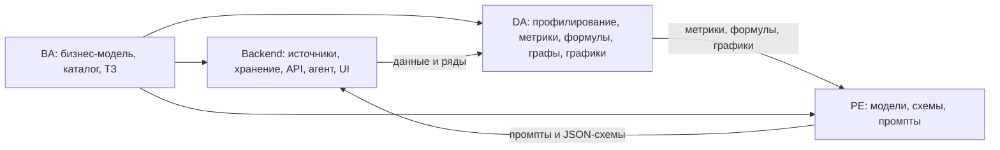

# Документация NAFA

Проект: NAFA, ИИ-ассистент для руководителей крупного бизнеса (кейс «Новостная аналитика для принятия бизнес-решений», Альфа-Банк × Changellenge). Команда: The Great New Alliance.

## С чего начать

1. Прочитать `01_BA_business_model_and_logic.md`: кому и зачем нужен сервис, как он приносит пользу банку, по каким правилам принимает решения.
2. Открыть своё ТЗ и выполнять задачи с приоритетом P0 в первую очередь. Метрики, источники, формулы и графики брать из справочника `05_reference_metrics_sources_formulas.md`.
3. Вопросы по данным и формулам сначала записываются в список вопросов организаторам (справочник, раздел 13.2).

## Файлы

| Файл | Кому | Выходные файлы роли (по таблице команды) |
|---|---|---|
| `01_BA_business_model_and_logic.md` | вся команда | Бизнес-модель и бизнес-логика NAFA |
| `05_reference_metrics_sources_formulas.md` | вся команда | Метрики, источники, формулы и методы анализа, графики, графовые структуры, качество, бюджет, риски, план |
| `02_TZ_backend_parsing.md` | Backend & Parsing | Parsing Sources; Descriptions of sources; Metrics |
| `03_TZ_data_analyst.md` | Data Analyst | Descriptions of metrics; Necessary formulas & calculations; Necessary graphics (PNG) |
| `04_TZ_prompt_engineer.md` | Prompt Engineer | Describe what LLMs to use for what processed data; Explain what metrics, formulas and graphs DA processed; Basic prompts for each metric, formula or graph |
| `data/*.csv` | все | Машиночитаемые справочники: каталог метрик (112), факторы, матрица отраслей, ОКВЭД → профиль, персоны, типы событий, реестр корпуса, архетипы, golden set |
| `assets/charts/` | DA | Папка для графиков `CH-xx_*.png` |

## Порядок работы и зависимости

## Соглашения

- ID метрик (`F-01`, `E-14`, `Q-04` и т.д.) закреплены в `data/metrics_catalog.csv`; менять их без согласования с BA нельзя.
- Пометка «допущение» означает гипотезу, которую нужно проверить или откалибровать.
- Все пороги и веса хранятся в конфигурации, а не в коде.
- Клиенты в тестах синтетические; реальные данные и PDF-отчёты Альфа-Банка в репозиторий не добавляются.
