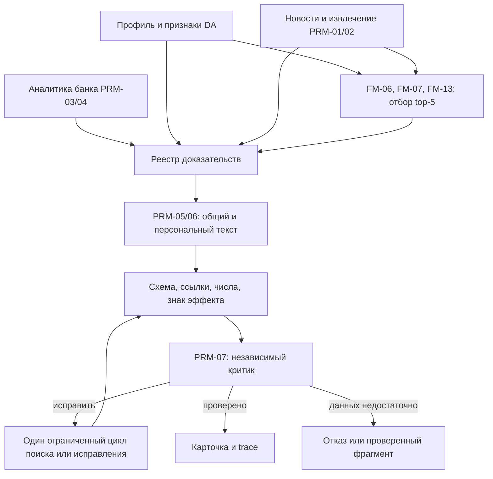

# ADR-001: интерпретация NAFA с проверяемыми доказательствами

Статус: реализованный PE-контур; интеграция и экспертная приёмка команды отдельно.
Дата: 25.10.2026. Участники согласования: PE, DA, Backend, BA.

## Контекст

Основа — предложенный пользователем ML-пайплайн S1–S6 с Evidence Ledger,
независимым критиком и метрикой BIQ. В NAFA уже есть реализации формул DA,
парсеров, поиска, шлюза и трейсов Backend. Задача PE — дать им проверяемые
схемы и промпты, переводящие рассчитанные значения в объяснение.

Источники проекта зафиксированы на прочитанных ревизиях:

| Источник | Ревизия | Основные файлы |
|---|---|---|
| BA | `f844ed6` | `docs/04_TZ_prompt_engineer.md`, `docs/05_reference_metrics_sources_formulas.md` |
| DA | `a623ed3` | `da_scripts/analytics/formulas.py`, `docs/da/02_formulas_and_calculations.md` |
| Backend | `1e794c8` | `store/app/agent/{orchestrator,tools}.py`, `store/app/llm_gateway.py` |

Ограничения: шесть разрешённых моделей, общий лимит 500 ₽ в сутки,
целевой расход до 400 ₽, незавершённая экспертная разметка. Измеренные результаты и задержки приведены в [отчёте](evaluation/acceptance_summary.md); рублёвые тарифы пока не подтверждены.

## Решение

Развивать существующий расчётный контур и добавить реестр доказательств между
инструментами и генератором. Выход модели становится набором утверждений с
ссылками на записи реестра. Сначала проверяется структура, затем содержание
проверяет критик другого семейства. Успех структурной проверки не разрешает
публикацию без следующих проверок.



### S1: профиль и экспозиции

Используем 12 факторов из `factors.csv`: RATE, FX, INFL, ENERGY, COMMOD,
DEMAND, LABOR, CREDIT, BUDGET, REG, GEOPOL, CPTY. Экспозиция ε задаёт
чувствительность в [0,1]; own/prior/chain объединяются реализациями DA
FM-03/04. Знак эффекта передаётся отдельно и берётся из расчётных правил.
Для RATE используем FM-14 и E-15. Если направление ВЭД неизвестно,
формулируем два условных исхода и вопрос, не выводим экспорт/импорт из страны.
NULL продуктового флага остаётся неизвестным значением.

Предложенные 25 драйверов, подписанная аддитивная экспозиция и PageRank
меняют уже реализованную модель DA. Их можно проверять отдельным экспериментом
после общего базового прогона; сейчас они не входят в контракт PE.

### S2: извлечение событий и позиции банка

PRM-01/02 возвращают тип события, факты со span, неотрицательную силу ι и
отдельное направление d. Отклонение от ожиданий входит в FM-12 (`Imp`),
поэтому ι не переопределяется как сюрприз. Сохранение ставки может иметь
ненулевую тематическую значимость и отдельную оценку сюрприза при наличии
подтверждённого ожидания.

Сохраняем `certainty = confirmed / forecast / opinion` из ТЗ. Слухи,
опровержения и планы требуют явной политики до расширения схемы.
BankView всегда содержит дату материала, документ, страницу и цитату;
оценка по изображению графика не становится подтверждённым числом без проверки.

### S3: отбор и ранжирование

Базовая реализация DA в `formulas.py`:

```text
Cov   = Σ ε_f · ι_f / Σ ι_f
Rel   = 0.7 · Cov + 0.3 · Match
Pers  = Σ persona_weight_f · ι_f / Σ ι_f
Score = Fresh · (0.40·Rel + 0.25·Imp + 0.10·Urg + 0.10·Nov + 0.15·Cred)
        · (0.5 + 0.5·Pers)
```

Порог и веса берутся из конфигов DA; MMR и top-5 уже предусмотрены FM-13.
Без факторного вектора нужна отдельная ветка обработки по Match, а не деление
на ноль. LambdaRank и LLM-реранжирование — будущие кандидаты для сравнения:
для их включения нужны разметка, независимый тест и измеренный бюджет.

Обнаружено расхождение: `docs/da/02_formulas_and_calculations.md`, раздел 3,
описывает FM-06 через `min(ι, ε)` и мультипликативный Match, тогда как
`formulas.py` реализует приведённую выше взвешенную сумму. Интеграция должна
закрепить реализацию и тестовые векторы; описание нужно согласовать с DA.

### S4: реестр доказательств и генерация

В реестре четыре типа записей:

| Тип | Проверяемый адрес | Назначение |
|---|---|---|
| NEWS_FACT | документ + диапазон символов + точная цитата | внешнее наблюдение |
| BANK_VIEW | то же + страница и дата документа | позиция банка |
| COMPANY_FEATURE | псевдоним клиента + поле + ID строки выгрузки | известный признак или NULL |
| COMPUTED_VALUE | FM-ID + ссылки на входы + ID расчёта | готовый результат DA |

Текст самой модели не используется как новый независимый источник. Цепочки
расчётов должны доходить до документов или строк данных, без циклов.
Внутри PE `Claim.source_ids` ссылается на ID записей реестра; при передаче
в Backend потребуется адаптер к его источникам и payload карточки.

PRM-05 кэширует общий разбор по событию, источникам, версии промпта и модели.
Ключ персонального PRM-06 дополнительно включает роль, версию профиля и
расчётов. Внешние документы передаются как данные в отдельном сообщении;
текст внутри не может добавлять инструменты или инструкции. Экранирование
разделителей само по себе не считается защитой от инъекций.

Пользователь видит три слоя ТЗ: факт, позиция банка, вывод AI. Условность
и ограничения отражаются внутри вывода AI; четвёртый слой ASSUMPTION
потребовал бы изменения контракта всей команды.

### S5: проверка и ограниченное исправление

1. Проверяем схему, ID, точность цитат, тип источника и принадлежность признаков.
2. Проверяем числа по конкретным процитированным данным с нормализацией
   десятичной запятой, процентов, единиц и дат. Наличие числа где-то в реестре
   не подтверждает его смысл, субъект или единицу измерения.
3. Сверяем `effect_sign`, `confidence` и результаты FM с переданными значениями.
4. Независимый критик проверяет смысл утверждений, свежесть, три слоя и шесть
   вопросов кейса. Точность критика оцениваем на отдельно размеченных парах claim–span.
5. Один повтор для неверного JSON предусмотрен ТЗ. Для всей карточки предлагается
   не более одного дополнительного цикла исправления с единым лимитом вызовов
   и токенов; вложенные повторы не запускаются без общего счётчика.
6. При нехватке данных возвращаем ограничения или проверенный фрагмент;
   непроверенные персональные советы не публикуем.

Минимум два канала и три признака — ориентиры для случаев, где данные их
поддерживают. Они не требуют выдумать второй канал при единственном известном.
ROUGE-L не используем как самостоятельный порог глубины: близость формулировок
не показывает, верна ли причинная цепочка.

### S6: оценка и трейсы

Сохраняем trace_id, prompt version/hash, модель, входные ID, результаты проверок,
вызовы, токены, задержку и стоимость. В запросы LLM идут только необходимые
агрегаты. Для контуров DA нужен экспорт `insight.claims[].source_ids` и
`sources[]`, сохраняющий признак синтетических данных и границы происхождения.

## Качество и BIQ

Обязательные метрики ТЗ остаются приёмкой: Q-01 ≥ 0.95, Q-03 ≤ 2%,
Q-29 ≤ 0.03, Q-08 ≥ 4.0, Q-15 ≥ 95%. NDCG@5 и персонализацию считает DA.
Это целевые пороги; фактические автоматические результаты и ограничения приведены в [отчёте](evaluation/acceptance_summary.md).

Предложенный BIQ можно добавить как экспериментальный показатель для абляций:

```text
Q   = GRND^0.25 · SEL^0.20 · PERS^0.20 · DEPTH^0.15 · BANK^0.10 · ACT^0.10
BIQ = ROB · max(0, Q · sqrt(Cov) − CER)
```

До расчёта нужно закрепить следующие определения:

- Все компоненты имеют диапазон [0,1]. `Lift` при baseline=1 не определён;
  при отсутствии компонента BIQ помечается «не измерен», а не пересчитывается
  по оставшимся весам. Это также касается Q_dev=0 в ROB и пустых групп Swap-AUC.
- Cov считается относительно фиксированного набора пар до отказов системы.
  CER — среди выданных инсайтов. Если выдачи нет, BIQ=0 и CER отмечается
  «не применимо»; число критических ошибок всегда показывается отдельно.
- Ошибки блокируют конкретную карточку. Непрерывный штраф CER в BIQ не
  гарантирует, что повышение других компонентов не компенсирует часть ошибок.
- NEE означает проверку чисел/дат/сущностей и их контекста. Совпадение строк
  — диагностический фильтр; CSR требует проверки смысла.
- BANK оцениваем отдельно для случаев с релевантной аналитикой и без неё.
  При удалении поддерживающей аналитики вывод может остаться тем же;
  обязательное изменение текста не доказывает корректное использование банка.
- Судейскую рубрику 0–4 из предложения нужно привести к шкале Q-08 1–5,
  явно описав соответствие до сравнения вариантов.

Порядок оценки: фиксированный baseline → + персонализация → + аналитика банка
→ + реестр → + критик. Общие тестовые пары, одинаковые ограничения бюджета,
парные интервалы с ресэмплингом по компаниям. Связанные GROUP_ID остаются
в одном сплите; временной тест отделён. Неполная разметка не превращает все
неразмеченные пары в нерелевантные. Синтетические и атакующие случаи сообщаются
отдельно от результатов на реальных данных.

## Варианты и компромиссы

| Вариант | Сложность | Стоимость | Проверяемость | Решение |
|---|---|---|---|---|
| Весь предложенный ML-контур сразу, 25 драйверов и обучаемый ранкер | высокая | пока неизвестна | нужна новая разметка и согласование формул | отложить до baseline |
| Готовые формулы NAFA + реестр + генератор и критик | средняя | измеряем через общий шлюз | сохраняет тесты DA и явные источники | предлагаемый путь |
| Только текущий детерминированный текст Backend | низкая | без генеративных вызовов | ограниченная глубина, честные provisional-метки | baseline и резерв |

## Что реализовано сейчас

`pe/evidence.py`: контракты реестра, точные span, разрешение ссылок, типы
источников, дата/страница банка, принадлежность признака клиенту, проверка
расчётных зависимостей на неизвестные входы и циклы. `check_card_provenance`
находит неизвестные ссылки, подмену слоя, mock-источники, несовпадение trace.
В отчёте всегда `semantic_support = not_checked`.

Команда проверки после сохранения карточки и реестра:

```bash
uv run python -m pe.cli EvidenceLedger
uv run python -m pe.cli InsightCard card.json --ledger ledger.json
uv run pytest
```

Реализованы все 17 промптов, независимая проверка, проверки чисел и знака,
один цикл исправления и повторного поиска через callback хоста, экспорт backend
и quality trace. API организаторов подключён; результаты реальных вызовов —
в [отчёте](evaluation/acceptance_summary.md). Внутренняя схема преобразуется
в формат API через `pe.integration.backend_payload`.

## Условия общей приёмки

1. Выгрузки DA рассчитаны на данных участников и подключены к ограниченному A/B (см. `08_real_participant_data.md`); подтвердить подключение к рабочему сервису backend.
2. Провести независимый ручной аудит карточек, не подменяя его LLM-оценкой.
3. Получить рублёвые тарифы для расчёта стоимости и суточной ёмкости.

BIQ, дополнительные драйверы и обучаемый ранкер остаются отдельными
экспериментами: они не нужны для исполнения текущего PE-контракта.
