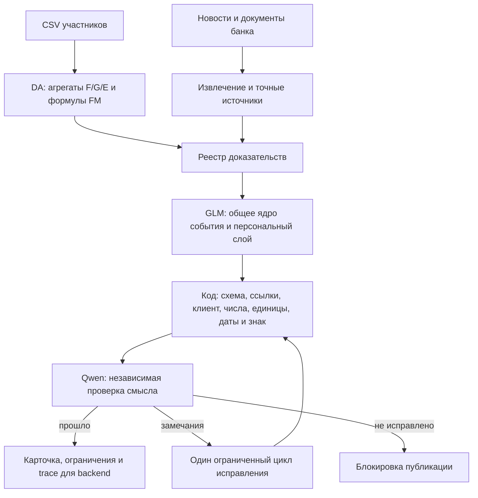

# NAFA: пакет для внешней оценки архитектуры и качества

Состояние на 26.10.2026. Просим оценить архитектуру, достаточность проверок и
предложить приоритетные улучшения. Это рабочий локальный прототип части Prompt
Engineer, а не заявление о завершённой приёмке или промышленном запуске.

Дополнение после внешнего разбора: [изменения и проверки](11_review_followup.md).
Подготовлены отдельные кандидаты с карточкой роли и атомарными ссылками;
текущий локальный прогон — 1107 тестов. [Живая проверка кандидатов](12_live_context_check.md)
выявила дефект ограничения контекста, который исправлен в v8. В 10 генерациях
7 карточек прошли код и критика; это один источник/клиент и три роли.
Независимый прирост качества не подтверждён. Ниже сохранены результаты прежних
экспериментов.

## Что решаем и какие ограничения

Финансовый новостной помощник для руководителя компании: объяснить, что произошло,
почему событие касается его бизнеса, возможные последствия и что стоит уточнить.
Ответ разделяет факт, позицию Альфа-Банка и вывод AI. Числа, релевантность,
экспозиции и знаки эффекта считает код DA; модель объясняет и проверяет.

Используем 12 факторов из существующей модели DA. Бюджет API организаторов —
500 ₽/сутки на общий ключ команды, рабочая цель — до 400 ₽. Подтверждённых
тарифов RUB/токен пока нет. Новые веса моделей не обучались и локально не
развёрнуты: разрешённые модели вызываются через API организаторов.

| Операция | Модель |
|---|---|
| Извлечение события, фактов и позиции банка | Gemma 4 26B A4B |
| Изображения страниц PDF | Qwen3-VL-30B-A3B-Instruct |
| Основная генерация общего и персонального разбора | GLM-5.3-Flash |
| Независимый критик | Qwen3.6 35B A3B |
| Сравниваемый генератор | DeepSeek-V4.1-Flash |
| Офлайн-оценка качества | Kimi-K2.6; в новых пилотах также DeepSeek |

Другие модели для компонентов решения не использовались. Полного сравнения
всех шести моделей на всех задачах нет.

## Архитектура

Реестр содержит четыре вида доказательств: NEWS_FACT и BANK_VIEW с документом,
точной цитатой и границами; COMPANY_FEATURE с псевдонимом и полем агрегата;
COMPUTED_VALUE с формулой и зависимостями. Вывод модели не становится новым
источником. Внешние тексты передаются как недоверенные данные; инструментов
генератору не предоставляется.

Реализованы 17 промптов, строгие Pydantic/JSON-схемы, кэш по запросу, версии
промптов, ограничение вызовов и ремонтов, учёт токенов и тайм-ауты. Предусмотрены
диалог, объяснения формул/графиков/версий/уверенности, предложения банка после
допуска правилом. Предложения продуктов не включены в обычную карточку автоматически.

Для backend подготовлены адаптер payload карточки, загрузка разрешённых
агрегатов DA, экспорт quality trace и патч существующего LLMGateway. Полный
рабочий HTTP/API-контур приложения с UI в рамках этих проверок не запускался.
Хост обязан учитывать publishable, partial, unknowns и удалённые утверждения.
Режимы replay/evaluation не разрешают публикацию результатов.

## Какие данные действительно прогнали

Все три CSV из официальной папки задания скачаны, проверены по SHA256 и
целиком прочитаны расчётным контуром закреплённой версии DA:

| Данные | Строк во входе | Фактическая обработка |
|---|---:|---|
| Компании | 85 525 | профилирование, F-признаки, экспозиции |
| Платежи | 1 380 585 | платёжные агрегаты, концентрации и графовые расчёты |
| Связи | 12 514 | локальные расчёты связей/агрегатов |

После принятого в DA keep-first остаётся 85 514 компаний. Один конфликтующий
ID содержит все 11 лишних строк; он остаётся в исходных агрегатах DA, но целиком
исключён из отбора для LLM. Три таблицы агрегатов согласованы по ключам,
экспозиции заполнены и находятся в [0,1]. Это проверка формы и вычислительного
контура, не доказательство экономической корректности каждого признака.

Исправлена нормализация CLIENT → existing для 41 968 компаний. PROSPECT
распознаётся как potential; CLOSE_CLIENT у 6 858 компаний оставлен неизвестным
до бизнес-подтверждения. Единицы выручки не подтверждены, поэтому она исключена
из запросов модели. Сырые ID компаний, групп и физических лиц также не передаются.
Демо-графики и качество с автоматически сгенерированной разметкой DA отключены.
В платёжном файле нет даты: доступны PAYER, BENEFICIARY, PAY_AMT и PAY_CNT.
Временная привязка профилей к событиям не подтверждена. Реальный smoke-test
проверяет работоспособность связки, а не исторический point-in-time backtest.

**Обработка всех CSV в DA не равна генерации карточек для всех компаний.**
Подготовлены три реальных профиля, но сквозной A/B через LLM выполнен только
для одного заёмщика на одной публикации DOC-07: две версии ответа на один вход.
Публикация из корпуса банка не является независимым подтверждением её прогноза.

## Проверки и результаты

| Проверка | Результат | Граница вывода |
|---|---|---|
| Локальные тесты PE | 1092 прошли | в числе них 1000 параметризованных синтетических случаев; это не 1092 независимых онлайн-эксперимента |
| Контрольные векторы DA | 44/44 | заданные численные примеры |
| Все 17 промптов | по 3 случая, 51/51 автоматических проверок | прохождение схем и правил не доказывает смысловую правильность |
| Генерация на seed | 12 случаев × 2 генератора, 24 прошли проверки | синтетические клиенты; одна GLM-карточка частичная |
| Q-08, старая рубрика | GLM: среднее 4.125, медиана 4.0; DeepSeek: среднее 3.864 | у GLM 12 оценок, у DeepSeek 11; одна оценка не получена |
| Внесённые ошибки | Qwen нашёл 9/10, Kimi 8/10 | у Kimi два неуспешных ответа учтены как неуспех |
| Разные атаки | 19/20 полностью прошли | оставшийся ответ заблокирован; это не универсальная гарантия безопасности |
| Отдельный LLM-аудит утверждений | 999/1000, Audit Score 0.997 | узкая синтетическая проверка, не качество полной бизнес-карточки |
| LLM-аудит + проверка кодом | 1000/1000 на том же наборе | правила находят подмены в контролируемой синтетике |
| Реальный профиль, новая рубрика | baseline 3.8, кандидат 3.8 | один клиент и один документ; прирост не подтверждён |

Q-01/Q-03/Q-29 от критика являются proxy, причём критик участвует в допуске
карточек. Значения 1.0/0.0 после допуска не являются независимым доказательством
отсутствия галлюцинаций. Экспертные оценки реальных карточек отсутствуют.

В тесте из 1000 случаев есть 100 базовых событий с десятью вариантами; split
600/200/200 сделан по группам событий. 200 инъекций внутри него — варианты одной
формы атаки, их не подменяем отдельным набором из 20 разных атак.

## Гипотеза улучшения и её результат

Baseline PRM-06 v4 сохранён. В v5/v6 канал разбит на событие, механизм,
признак компании, следствие и условие пересмотра; у каждого шага свои ссылки.
Вопросы связываются с механизмом и объясняют использование ответа. Рендерер
собирает обычную карточку, которую проверяет прежний независимый критик.

На первом пилоте выявлен конфликт общего ремонта JSON с вложенной схемой;
он исправлен, неуспешная попытка сохранена. На втором пилоте два оценённых
синтетических случая дали кандидату 4.0/4.0 против 3.8/4.0 у baseline;
третий кандидат остановился по тайм-ауту критика. Парное сравнение в обоих
порядках и оценка двумя судьями не завершены полностью. На реальном профиле
получилась ничья 3.8/3.8; кандидат частичный. В рабочем manifest остаётся v4.

Новая рубрика считает среднее пяти осей и иначе фиксирует якоря. Старые 4.125
и новые 3.8 напрямую не сравниваются. Подготовлены 60 синтетических вариантов
в 10 сюжетных семействах с раздельными dev/validation/test; это не 60 независимых
реальных событий. Закрытые наборы не оценивались. Медиана 4.5 на независимых
реальных данных не достигнута и не заявляется.

Weighted binary log loss и экспорт train/validation для будущего SFT подготовлены
только для узкой задачи аудита. Дообучения, LoRA, оптимизации генератора по
оценкам судьи и обученного ранкера нет. Исходные CSV не содержат готовых
эталонных ответов или экспертных оценок карточек.

## Почему полная приёмка ещё не закрыта

1. Нет репрезентативного сквозного прогона на разных реальных клиентах и событиях,
   слепой человеческой разметки и независимой итоговой оценки.
2. Не подтверждена интеграция PE с рабочим HTTP/API backend и интерфейсом:
   проверены локальные адаптеры и вычислительный сквозной пример.
3. VLM иногда ошибается в субъекте, периоде и атрибуции числа. Все сырые
   VLM-страницы требуют сверки и блокируются перед BankInput; в генерационных
   тестах используются подготовленные записи корпуса. Семантическое качество
   автоматического PDF-потока не принято.
4. Не подтверждены рублёвые тарифы и ёмкость при цели 400 ₽/сутки. Токены
   измерены; неизвестная стоимость сохраняется как null. Серверный предел
   500 ₽ не является расчётом стоимости карточки.
5. Сохраняются вопросы к данным и методике: CLOSE_CLIENT, единицы выручки,
   расхождение описания и реализации FM-06, начальный confidence до критики.

## Что просим оценить

- Какие части схемы избыточны, а какие действительно ограничивают качество?
  Стоит ли сохранять вложенный план, упрощать его или прежде улучшить контекст?
- Как выделять только относящиеся к событию фрагменты? Сейчас бюджетный фон
  попал в карточку по пересмотру ставки без собственной полезной связи.
- Как передавать описание роли пользователя, признаки и экономические правила,
  чтобы получить конкретные действия без выдуманных сумм и договоров?
- Как проверять обоснованность условных причинных выводов и зависимости
  computed evidence, не принимая наличие ссылки за доказательство смысла?
- Как откалибровать судью под доступность данных? Он ограничил mechanisms за
  единственный обоснованный канал, хотя рубрика допускает такой вход.
- Какой независимый набор, единица группировки и человеческая разметка нужны,
  чтобы честно проверить цель около 4.5 и не подстроиться под одного судью?
- Как обеспечить надёжный PDF-поток, разумные задержки, кэширование общего ядра
  и бюджет при росте количества клиентов?
- Есть ли основания для дообучения сейчас? Если да, какую разметку, baseline
  и проверку переноса нужно подготовить прежде?

Просим выдать 3–5 приоритетных изменений: наблюдаемая проблема → изменение →
контрольный эксперимент → критерий успеха/регрессии → цена и риски.
Просим отдельно отметить, какие выводы уже следуют из проверок, а какие
пока не обеспечены данными. Увеличение оценки само по себе не критерий успеха
при росте ошибок, тайм-аутов или стоимости.

## Материалы для проверки

- `README.md`, `docs/pe/01_llm_mapping.md` — запуск и маршрутизация.
- `pe/pipeline.py`, `evidence.py`, `session.py`, `integration.py` — основной контур.
- `pe/interpretation.py`, `prompts/profiles/`, `pe/improvement.py` — кандидат и A/B.
- `docs/pe/evaluation/acceptance_results.json`, `case_results.jsonl` — исходные результаты.
- `docs/pe/evaluation/participant_data/` — агрегированная проверка данных и реальный A/B.
- `docs/pe/07_improvement_protocol.md`, `08_real_participant_data.md` — детали новых проверок.
- `prompts/token_budget.csv` — замеры токенов, без вымышленных рублёвых цен.

В review-архив входят код, тесты, схемы, промпты и обезличенные отчёты. Сырых CSV,
локальных баз, private_id_mapping, API-ключа и Git-метаданных в нём нет. Это
снимок локального рабочего дерева, а не опубликованный релиз или merge в main.
